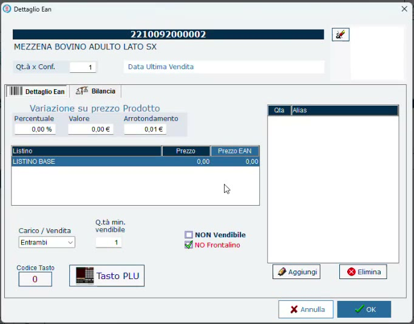
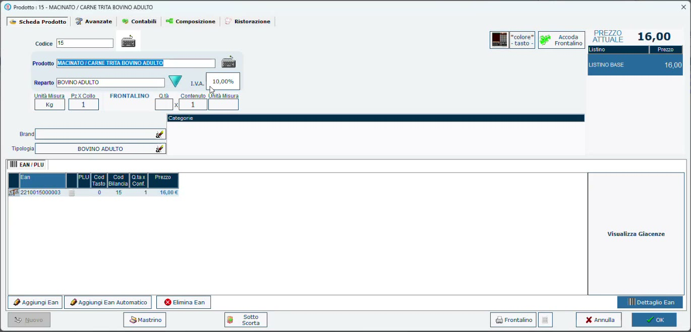

# Articoli: mezzena, tagli e macinato

**Target:** tecnico installatore.

## Obiettivo

Impostare correttamente in anagrafica i tre tipi di articolo che compongono il flusso della macelleria: la **mezzena** in ingresso, i **tagli** venduti al banco e il **macinato**, che è una lavorazione.

## Prerequisiti

- Le definizioni tracciabili sono già state create ([Definizioni tracciabili](definizioni-tracciabili.md)).

## I tre tipi di articolo

| Articolo | Ruolo | Impostazioni chiave |
|----------|-------|---------------------|
| **Mezzena** (lato sinistro / lato destro) | Prodotto in ingresso: si carica, non si rivende | **Deperibile** + **Lotti**; un EAN per fornitore, ognuno con la sua definizione tracciabile |
| **Taglio** (filetto, noce, fiorentina) | Prodotto in uscita, ricavato dalla mezzena con un semplice taglio | Tasto sulla bilancia; nessun lotto di lavorazione: in vendita usa il lotto della mezzena |
| **Macinato** | Prodotto ricavato dalla mezzena con una lavorazione | **Produzione Propria**: genera un lotto di produzione |

## Passaggi

### 1. La mezzena

1. Apri **Prodotti** e crea (o richiama) l'articolo, per esempio **MEZZENA BOVINO ADULTO LATO SX**. Nell'archivio del webinar le mezzene sono due articoli distinti: lato sinistro e lato destro.
2. Nella scheda **Avanzate** attiva **Deperibile** e **Lotti**: sono le uniche due informazioni indispensabili per il prodotto in ingresso.
3. La stessa mezzena può arrivare da **più fornitori**. Con **Aggiungi Ean** crea un EAN (anche interno) per ciascun fornitore.
4. Seleziona l'EAN, premi **Dettaglio Ean** e, nella scheda **Bilancia**, associa la **Definizione Tracciabilità** preconfigurata: per esempio la definizione precompilata del fornitore su un EAN e una definizione ridotta sull'altro.

*Dettaglio Ean della mezzena: la definizione si associa dalla scheda Bilancia.*

!!! tip "Perché un EAN per fornitore"
    Al momento del carico la mezzena viene proposta una volta per ogni EAN: scegliendo quello del fornitore giusto, la definizione e i suoi valori predefiniti sono già pronti.

### 2. I tagli

Il filetto, la noce o la fiorentina sono **prodotti in uscita**. Nella scheda dell'articolo si indica su quale **tasto della bilancia** collocarlo in vendita. Il taglio non subisce un lotto di lavorazione: quando lo si vende, la bilancia chiede da quale lotto di mezzena proviene.

### 3. Il macinato

Anche il macinato proviene dalla mezzena, ma subisce un **processo di lavorazione**: non è solo carne passata nel tritacarne, perché vengono aggiunti altri componenti per la conservazione, e può essere un **macinato misto** di bovino e suino. Per questo, nella scheda **Avanzate**, va attivato **Produzione Propria**: ogni lavorazione diventa una produzione interna a cui assegnare un lotto.

*Scheda prodotto del macinato. Le opzioni Deperibile, Lotti e Produzione Propria sono nella scheda Avanzate.*

## Verifica

- Cercando la mezzena in un carico, compare una riga per ogni EAN con la relativa definizione.
- I tagli sono presenti sulla tastiera della bilancia.
- Il macinato è selezionabile come prodotto di destinazione in un modello di trasformazione ([Dalla mezzena al macinato](trasformazione-macinato.md)).

## Errori comuni

| Problema | Causa probabile | Rimedio |
|----------|-----------------|---------|
| La trasformazione non chiede il lotto del prodotto finito | Il prodotto di destinazione non ha la gestione dei lotti attiva | Attiva **Lotti** e **Produzione Propria** sul prodotto lavorato |
