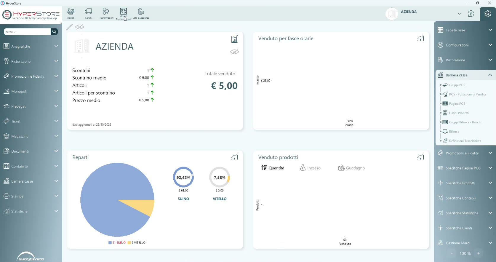
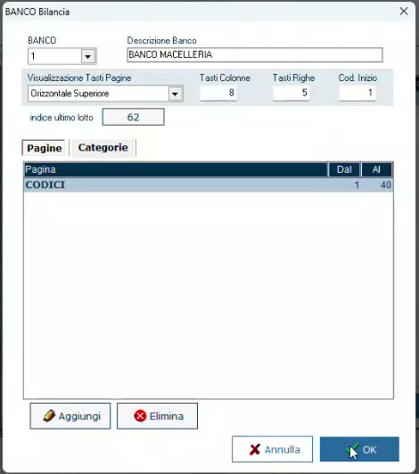
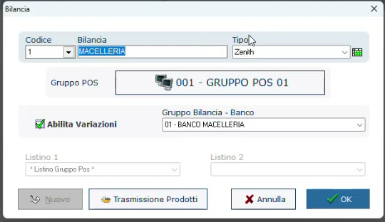

# Banchi e bilance in HyperStore

## Obiettivo

Definire in HyperStore il **banco** (gruppo bilancia) della macelleria e collegargli la **bilancia Icona**, così che articoli, definizioni e lotti arrivino sulla bilancia.

## Prerequisiti

- HyperStore con il modulo **LiveRetail**.
- Bilancia Icona raggiungibile in rete.

## Dove si trova

Apri il menu delle impostazioni (l'ingranaggio in alto a destra) e la sezione **Barriera casse**. Le tre voci che servono sono:

| Voce | A cosa serve |
|------|--------------|
| **Gruppi Bilance - Banchi** | I banchi del negozio |
| **Bilance** | Le singole bilance, ognuna collegata a un banco |
| **Definizioni Tracciabilità** | Le definizioni tracciabili (vedi [Definizioni tracciabili](definizioni-tracciabili.md)) |

*HyperStore: in alto i pulsanti Prodotti, Carichi, Trasformazioni, Modelli Trasformazioni e Lotti e Scadenze; a destra la sezione Barriera casse.*

## Passaggi

### 1. Crea il banco

Un **gruppo bilancia** corrisponde a un **banco**. Apri **Gruppi Bilance - Banchi**, premi **Aggiungi** e compila la scheda (nell'esempio **BANCO MACELLERIA**). Nella scheda **Pagine** puoi limitare l'intervallo dei PLU gestiti dal banco.

!!! info "Icona non ha limiti pratici di PLU"
    Icona ha a bordo un database strutturato (PostgreSQL): può arrivare fino a **50.000 articoli** senza risentirne.

### 2. Crea la bilancia e collegala al banco

Apri **Bilance**, premi **Aggiungi** e indica il nome, il **Tipo** e il **Gruppo Bilancia - Banco** di riferimento. Da quel momento tutto ciò che accade sul banco coinvolge quella bilancia.

Nell'esempio la bilancia è di tipo **Zenith**: è il protocollo dei driver tradizionali, tuttora in funzione sulla bilancia. HyperStore dialoga inoltre con l'ecosistema Icona tramite **API**, in modo istantaneo: è questo che permette di avere definizioni e lotti sulla bilancia in tempo reale.

### 3. Aggiungi altre bilance, se servono

Allo stesso banco puoi collegare più bilance. Il programma è **multi-negozio**: nella stessa struttura si gestiscono più punti vendita, anche con bilance di modelli diversi.

!!! warning "Tracciabilità: solo con Icona"
    Al momento le bilance compatibili con la gestione della tracciabilità da HyperStore sono **solo le Icona**.

## Verifica

- Nell'elenco **Bilance** la bilancia compare con il banco corretto nella colonna **Gruppo Pagine**.
- Una modifica fatta in HyperStore (per esempio a una definizione) si ritrova sulla bilancia senza trasferimenti manuali.
