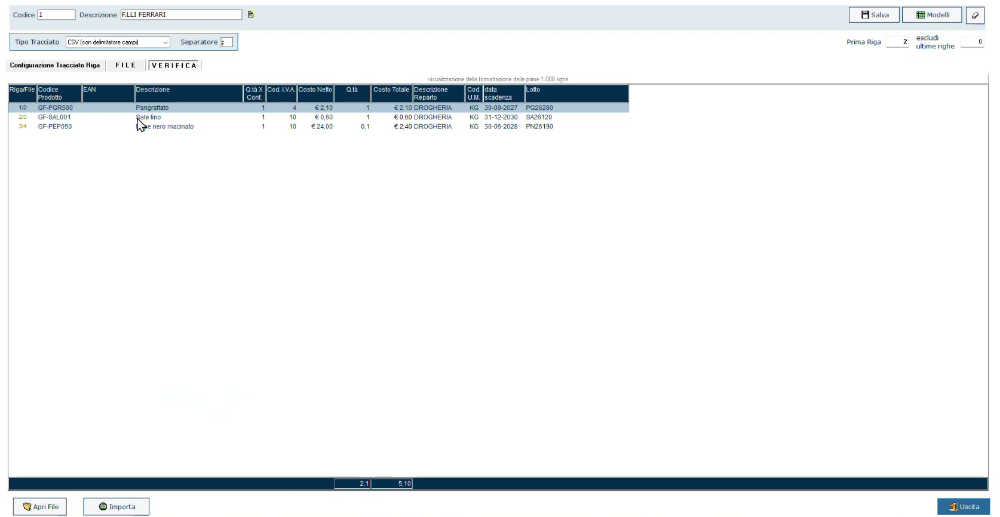
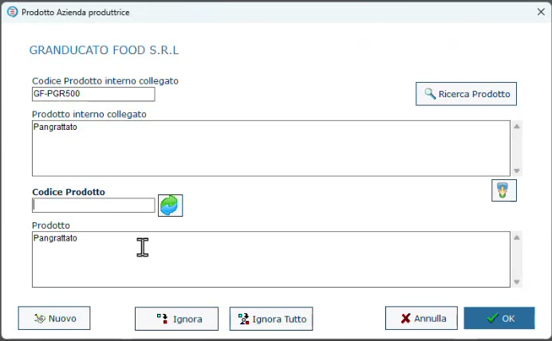
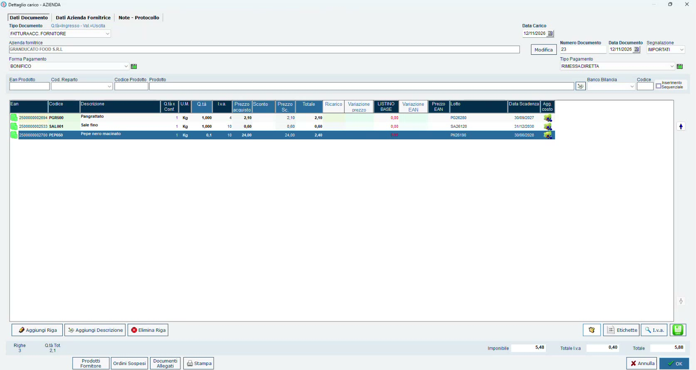

# Carico degli ingredienti da CSV

## Obiettivo

Caricare a magazzino gli ingredienti acquistati, acquisendo dal file del fornitore **lotti e date di scadenza** in un'unica operazione, e collegare i codici del fornitore ai codici interni.

## Prerequisiti

- Fornitore con **Gestione Prodotti** e **Aggiornamento Listino** attivi ([Prodotto finito e ingredienti](prodotto-finito-ingredienti.md)).
- Il documento del fornitore (DDT o fattura) e, se disponibile, il relativo file **CSV**.

## Passaggi

### 1. Apri il documento di carico

1. Apri **Carichi** e premi **Aggiungi**.
2. Scegli il **Tipo Documento**. Con la **fattura accompagnatoria** si aggiornano insieme la quantità in ingresso e il valore; in alternativa usa la bolla di carico (DDT).
3. Indica il fornitore, il **Numero Documento** e la **Data Documento**.
4. Compila, se serve, la **Segnalazione** (nell'esempio *IMPORTATI*): è un'etichetta libera utile per ritrovare il documento con una ricerca.
5. Indica forma e tipo di pagamento.

### 2. Importa le righe dal file

Le righe si possono inserire a mano, ma se il fornitore consegna un file conviene importarlo.

1. Avvia l'importazione da file e scegli il **modello di tracciato**.
2. Seleziona il file CSV ricevuto dal fornitore.
3. Nella scheda **VERIFICA** controlla l'anteprima delle righe: codice prodotto, descrizione, quantità, costo, reparto, **data scadenza** e **lotto**.
4. Premi **Importa**.

*L'anteprima dell'importazione: le ultime due colonne sono data di scadenza e lotto.*

!!! tip "Un tracciato per fornitore"
    Conviene creare un modello di tracciato per ciascun formato di CSV del fornitore, anziché modificare il file ogni volta. Data di scadenza e lotto sono i due dati che permettono di caricare tutto in un'unica soluzione.

### 3. Collega i codici del fornitore ai tuoi

La prima volta che arriva un prodotto di quel fornitore, il programma chiede a quale **prodotto interno** collegarlo: puoi cercarne uno esistente oppure crearlo.

*Il collegamento tra il codice del fornitore e il prodotto interno.*

Collegare i codici ha tre vantaggi:

- lo stesso ingrediente acquistato da **fornitori diversi** resta un unico articolo: non si moltiplicano inutilmente i PLU nel database;
- alle importazioni successive le domande **non vengono più fatte**;
- si costruisce il **listino del fornitore**: si può sapere quando un prodotto è stato comprato l'ultima volta e a che prezzo.

!!! note "Il codice fornitore non è obbligatorio"
    Non è obbligatorio specificarlo, ma è ciò che evita di rispondere alle stesse domande a ogni carico.

### 4. Controlla e conferma

Le righe importate riportano per ogni ingrediente quantità, prezzo di acquisto, **Lotto** e **Data Scadenza**. Conferma il documento con **OK**.

*Il documento di carico compilato dall'importazione.*

!!! info "Il lotto sul documento è un obbligo del fornitore"
    Non tutti i fornitori sono attrezzati per consegnare un file, soprattutto i più piccoli. Tutti però hanno l'obbligo di legge di riportare il lotto sul documento, che sia una bolla, un foglio di carico o un DDT: in quel caso lotto e scadenza si inseriscono a mano.

## Verifica

- Nella scheda di ogni ingrediente la giacenza è aumentata.
- I lotti caricati sono disponibili come origine quando si esegue una trasformazione ([Eseguire una trasformazione](eseguire-trasformazione.md)).

## Errori comuni

| Problema | Causa probabile | Rimedio |
|----------|-----------------|---------|
| A ogni carico viene richiesto il collegamento del prodotto | Il codice del fornitore non è stato collegato al prodotto interno | Completa il collegamento alla prima richiesta |
| Lo stesso ingrediente compare come più articoli | È stato creato un prodotto nuovo invece di collegarlo a quello esistente | Collega i codici dei diversi fornitori allo stesso prodotto interno |
