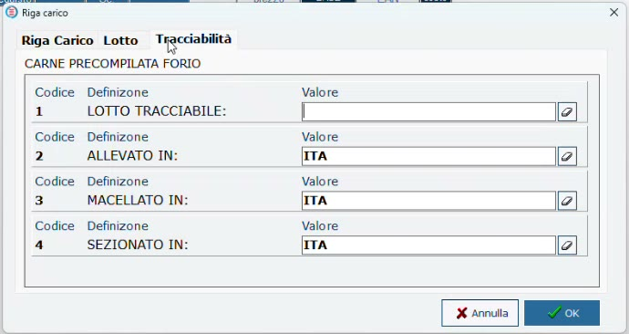

# Carico della mezzena e del lotto

## Obiettivo

Registrare in HyperStore l'arrivo di una mezzena con peso, scadenza, lotto e dati tracciabili. Con questa sola operazione la merce entra a magazzino e il **lotto diventa disponibile sulla bilancia**.

## Prerequisiti

- Articolo mezzena con **Deperibile** e **Lotti** attivi e definizione associata all'EAN ([Articoli: mezzena, tagli e macinato](articoli-mezzena-tagli.md)).
- Il documento del fornitore (bolla, foglio di lavorazione o fattura) con il lotto.

## Passaggi

1. Apri **Carichi** e premi **Aggiungi**.
2. Scegli il **Tipo Documento**: fattura accompagnatoria oppure bolla.
3. Richiama l'**Azienda fornitrice** e inserisci **Numero Documento**, **Data Documento** e i dati di pagamento.
4. Cerca il prodotto (per esempio *MEZZ*). La mezzena lato sinistro compare **più volte**, una per ogni EAN creato: accanto a ciascuna è indicata la definizione associata. Seleziona quella del fornitore.
5. Nella finestra **Riga carico**, scheda **Riga Carico**, indica il **peso** della mezzena (nell'esempio **126 kg**).
6. Nella scheda **Lotto** inserisci i dati del lotto letti sul documento, tra cui la **data di scadenza**.
7. Nella scheda **Tracciabilità** compaiono le domande della definizione. Scrivi il **lotto tracciabile** (nell'esempio **LT1315**) e controlla i valori proposti.
8. Conferma la riga e chiudi il documento con **OK**.

*I campi della definizione precompilata: il lotto si digita, il resto è già proposto.*

!!! tip "I valori predefiniti sono solo una proposta"
    Se proprio quella mezzena è diversa dal solito (per esempio macellata e sezionata in Italia ma **allevata in Francia**), puoi correggere il valore proposto prima di confermare.

## Che cosa succede alla conferma

- La mezzena viene **caricata a magazzino**.
- Il lotto viene **comunicato alla bilancia**, con il suo peso. Non serve alcun comando di trasferimento o di allineamento delle bilance: chi ha caricato la bolla dall'ufficio o dal laboratorio non deve fare altro.

!!! info "Perché il peso va sulla bilancia"
    Il controllo del peso residuo del lotto è gestito dalla bilancia: per questo il lotto viene inviato con i chilogrammi caricati, che poi scendono a ogni pesata.

## Verifica

1. Sulla bilancia richiama un taglio della mezzena.
2. Nell'elenco dei lotti proposti deve comparire il lotto appena caricato, con il peso indicato nel documento ([Vendita al banco con il lotto](vendita-bilancia.md)).

## Automatizzare il carico

Nell'esempio i dati sono inseriti a mano, ma dove ci sono le condizioni possono essere **importati** dal file del fornitore: la procedura è mostrata in [Carico degli ingredienti da CSV](carico-ingredienti.md).
