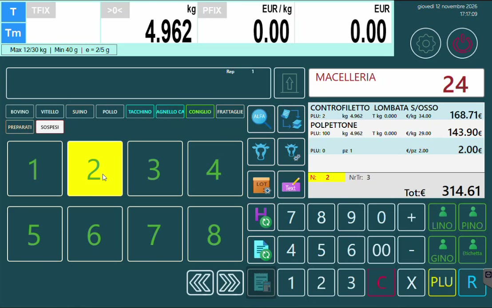

# Conti sospesi e comande

## Obiettivo

Usare i **conti sospesi** della bilancia Icona: parcheggiare le pesate su un conto, aggiungerne altre in momenti diversi e con operatori diversi, stampare una **comanda** e chiudere il conto con lo scontrino.

## A che cosa servono

Un conto sospeso può rappresentare ciò che serve all'attività: per esempio un **tavolo** davanti al banco, dove il cliente si siede e consuma un hamburger preparato al momento. La funzione estende così l'uso della bilancia ad attività in cui il cliente consuma sul posto.

## Passaggi

### 1. Aprire un conto

1. Scegli il **conto** a cui assegnare la vendita (nell'esempio il conto 2).
2. Seleziona il prodotto e, come sempre, il **lotto** di riferimento.
3. Conferma la pesata sull'operatore.

Le battute restano parcheggiate sul conto, che viene **evidenziato**. Si può tornare alla schermata di vendita e servire altri clienti.

*Il conto 2 è evidenziato: contiene due articoli a peso e un importo manuale.*

### 2. Aggiungere altre voci

Toccando il conto la bilancia mostra le battute già caricate e il loro valore. Si possono aggiungere:

- altri prodotti, sempre con il loro lotto;
- un **importo manuale** (nell'esempio 2,00 euro);
- voci inserite da un **altro operatore**: non deve essere lo stesso che ha aperto il conto.

### 3. Intervenire sul conto

| Gesto | Che cosa fa |
|-------|-------------|
| **Pressione prolungata** sul conto | Apre le funzioni sul conto: storno, oppure stampa delle vendite |
| **Tocco singolo** sul conto | Chiede a chi assegnare la **comanda** |

### 4. Stampare la comanda

Dopo il tocco singolo si sceglie a chi assegnare la comanda (nell'esempio un collaboratore) e la bilancia la stampa: riporta il conto, o tavolo, e gli articoli presi. Chi riceve la comanda può aggiungere altri prodotti in seguito.

### 5. Chiudere il conto

Richiama il conto e premi il **totale**: la bilancia emette lo scontrino e il conto viene chiuso definitivamente.

!!! info "Il conto non segue la data di lavoro"
    Un conto sospeso può restare aperto anche **per più giorni**: non è legato alla data di lavoro della bilancia.

!!! tip "Personalizzazione"
    I conti sospesi sono personalizzabili in programmazione: il nome può essere "conto", "tavolo", "cliente" o ciò che serve all'attività.

## Verifica

- Dopo aver assegnato una pesata, il conto risulta evidenziato e toccandolo si rivedono le battute.
- Dopo il totale il conto torna libero.
