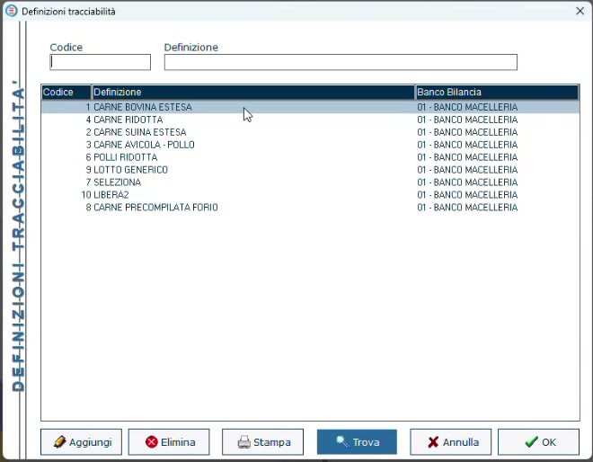
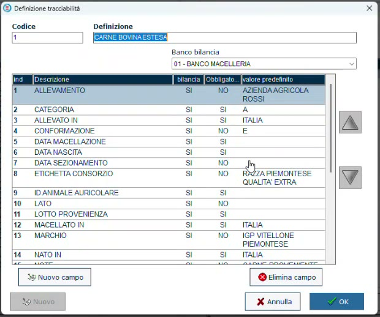
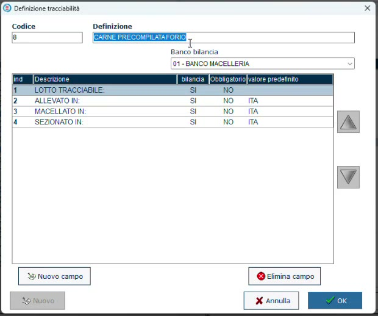
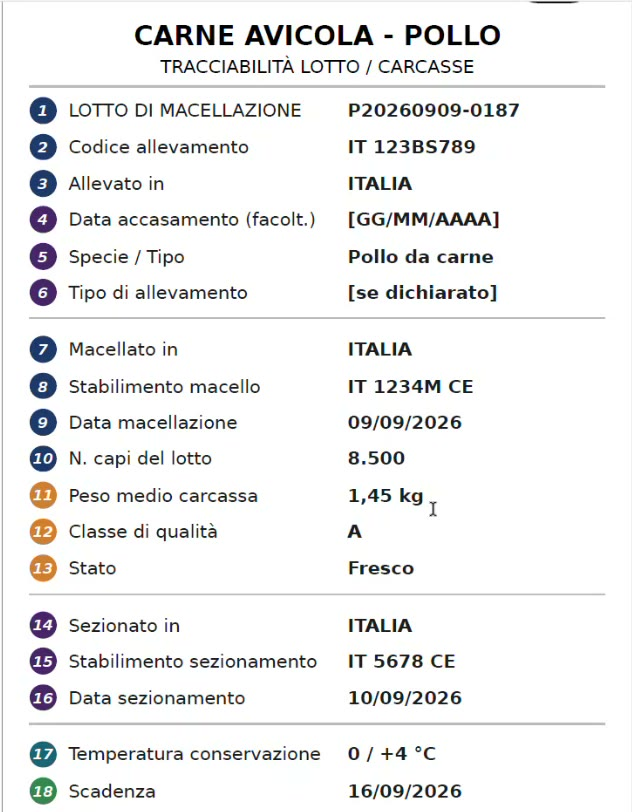
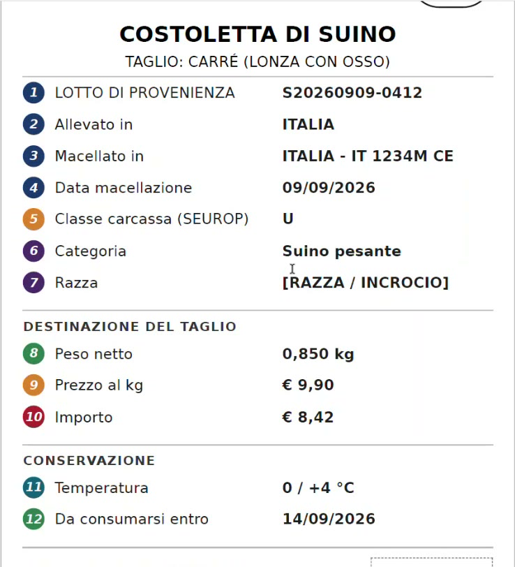

# Definizioni tracciabili

**Target:** tecnico installatore / rivenditore.

## Obiettivo

Creare in HyperStore le **definizioni**, cioè gli elenchi di domande a cui si risponde quando si carica una mezzena o si vende un suo taglio, scegliendo per ogni campo se inviarlo alla bilancia, se è obbligatorio e se ha un valore predefinito.

## Prerequisiti

- Banco e bilancia configurati ([Banchi e bilance in HyperStore](banchi-bilance.md)).
- L'elenco dei dati da gestire concordato con il macellaio ([Concetti e obblighi](tracciabilita-carni.md)).

## Dove si trova

Impostazioni → **Barriera casse** → **Definizioni Tracciabilità**. Ogni definizione è associata a un **Banco Bilancia**.

*Le definizioni dell'archivio dimostrativo, tutte sul banco macelleria.*

## Tre modi di costruire una definizione

| Tipo | Che cosa contiene | Quando conviene |
|------|-------------------|-----------------|
| **Estesa** (es. CARNE BOVINA ESTESA) | Tutte le informazioni presenti sull'etichetta del macello | Quando si vuole conservare in HyperStore l'intera scheda della mezzena |
| **Ridotta** (es. CARNE RIDOTTA) | Solo l'essenziale: lotto tracciabile, nato in, allevato in, sezionato in, senza valori predefiniti | Gestione leggera, riutilizzabile anche per altri prodotti |
| **Precompilata** (es. CARNE PRECOMPILATA di un fornitore) | Pochi campi con le risposte già inserite | Quando la carne di un fornitore è sempre, per esempio, allevata, macellata e sezionata in Italia |

## Passaggi

1. In **Definizioni Tracciabilità** premi **Aggiungi**.
2. Compila **Codice** e **Definizione** (il nome) e scegli il **Banco bilancia**.
3. Con **Nuovo campo** aggiungi una riga per ogni informazione da gestire.
4. Per ogni campo imposta le tre colonne descritte nella tabella qui sotto.
5. Conferma con **OK**.

| Colonna | Significato |
|---------|-------------|
| **bilancia** (SI / NO) | Se il campo viene inviato alla bilancia oppure resta solo in HyperStore |
| **Obbligatorio** (SI / NO) | Se è SI, senza quel dato la mezzena non può essere caricata correttamente: sono le informazioni richieste per legge |
| **valore predefinito** | La risposta proposta in automatico al carico, comunque modificabile |

*Definizione estesa: molti campi, alcuni obbligatori, alcuni con valore predefinito.*

*Definizione precompilata per un fornitore: quattro campi, tre già valorizzati con ITA.*

!!! info "Sincronizzazione in tempo reale"
    Mentre lavori in questa sezione le informazioni vengono già comunicate alla bilancia: ogni modifica alle definizioni è riportata in tempo reale, senza comandi di invio.

## Ogni specie ha la sua definizione

La definizione cambia a seconda della carne: le dinamiche sono simili ma non identiche, e cambiano anche le etichette.

| Carne | Particolarità |
|-------|---------------|
| **Bovina** | La più articolata: ID animale, nascita, allevamento, macellazione, sezionamento |
| **Avicola** (pollo) | Si ragiona per lotto di macellazione; tra i dati facoltativi c'è il **tipo di allevamento** (a terra oppure in gabbia), oggi molto richiesto |
| **Suina** | Richiede meno informazioni in lavorazione; si può indicare se la carne è di razza pura o di **incrocio** e la **classe della carcassa (SEUROP)**, che nel webinar viene collegata alla percentuale di grasso |

*Esempio dei dati di un lotto di carne avicola.*

*Esempio dei dati di un taglio di suino.*

## Verifica

- La definizione compare nell'elenco con il banco corretto.
- Sulla bilancia la definizione è disponibile tra quelle associabili a un lotto (vedi [Lotti tracciabili dalla bilancia](lotti-da-bilancia.md)).

## Errori comuni

| Problema | Causa probabile | Rimedio |
|----------|-----------------|---------|
| Al carico vengono chieste troppe informazioni | È stata associata una definizione estesa | Crea una definizione ridotta o precompilata per quel fornitore |
| Un dato non compare sulla bilancia | Il campo ha la colonna **bilancia** a NO | Impostala a SI se il dato serve in vendita o in etichetta |
| Il carico non si completa | Manca la risposta a un campo **Obbligatorio** | Recupera il dato dal documento del fornitore |
