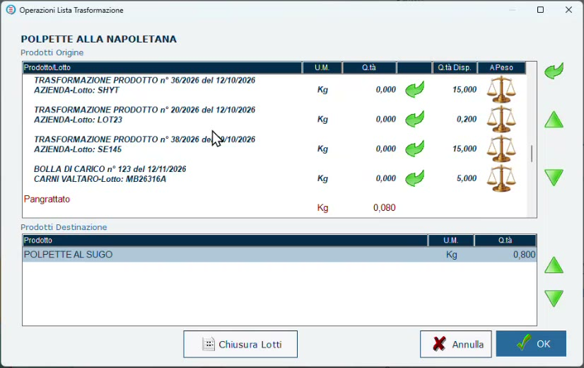

# Eseguire una trasformazione

**Target:** operatore di back office / tecnico installatore.

## Obiettivo

Registrare una produzione: scegliere la ricetta, la quantità da produrre e **da quali lotti prelevare ogni ingrediente**, assegnando al prodotto finito il suo **lotto di produzione** e la scadenza.

## Prerequisiti

- Modello di trasformazione creato ([Modelli di trasformazione](modelli-trasformazione.md)).
- Ingredienti caricati a magazzino con i loro lotti ([Carico degli ingredienti da CSV](carico-ingredienti.md)).
- Prodotto di destinazione con **Lotti** e **Produzione Propria** attivi.

## Passaggi

1. Apri **Trasformazioni** e premi **Aggiungi**.
2. Scegli **che cosa preparare**, cioè il modello di trasformazione.
3. Indica la **quantità** da produrre.
4. Il programma calcola le quantità degli ingredienti **in proporzione** alla ricetta. Nell'esempio, per 800 g di polpette servono 640 g di macinato, 80 g di pangrattato e 80 g di Parmigiano.
5. Per ogni ingrediente scegli **da quale lotto prelevare**: l'elenco mostra i documenti di carico (o le trasformazioni precedenti) con il lotto e la quantità disponibile.
6. Premi **Lotto Prodotti destinazione** e scrivi il **lotto interno** del prodotto finito (nell'esempio **LT261112**).
7. Conferma con **OK**.

*La scelta dei lotti di origine: per ogni documento sono indicati lotto e quantità disponibile.*

!!! info "Anche un trasformato può essere un'origine"
    Tra le origini compaiono anche le **trasformazioni precedenti**: il macinato usato per le polpette è a sua volta il risultato di una trasformazione della mezzena, e porta con sé il proprio lotto.

## Che cosa succede alla conferma

- La trasformazione viene registrata con la **scadenza già calcolata** in base ai giorni indicati nel prodotto: nell'esempio il polpettone, con 3 giorni di scadenza, prodotto il 12/11 scade il 15/11.
- Il prodotto finito viene **caricato** a magazzino con il suo lotto.
- Gli ingredienti vengono **scaricati** dai lotti scelti: è il programma a diminuire quantità e pesi dei lotti di origine, come fa la bilancia quando vende un taglio della mezzena.

## Verifica

Nella **Lista Trasformazioni** la produzione compare con il lotto e la scadenza ([Rintracciabilità dei lotti](rintracciabilita-lotti.md)).

## Errori comuni

Sono i casi capitati davvero durante la dimostrazione.

| Problema | Causa | Rimedio |
|----------|-------|---------|
| Non viene chiesto il lotto del prodotto finito e la trasformazione risulta senza lotto | Sul prodotto di destinazione non è attiva la gestione dei **Lotti** | Attiva **Lotti** nella scheda Avanzate del prodotto e ripeti la trasformazione |
| La quantità di un ingrediente non si completa | Il lotto scelto non ha quantità sufficiente, oppure è esaurito | Preleva da un altro lotto che abbia disponibilità |
| Le uova di un carico non bastano | La quantità richiesta supera quella del singolo documento | Preleva dal documento che ha la quantità necessaria |

!!! tip "Nella realtà i lotti sono pochi"
    Nell'archivio dimostrativo l'elenco dei lotti è lungo perché viene usato per molte prove. In un negozio reale i lotti aperti per ogni ingrediente sono molti meno e la scelta è immediata.

!!! note "Più semplice di quanto sembri"
    I passaggi in più riguardano la preparazione (ingredienti, ricette), che si fa una volta sola. Una volta definito tutto, è il programma a guidare nella creazione del lotto di lavorazione.
