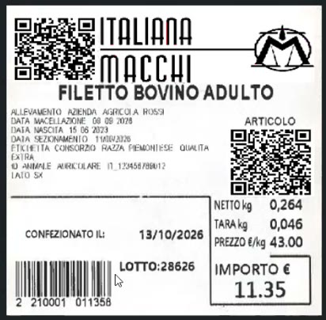
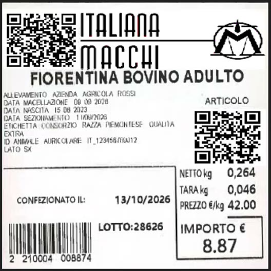
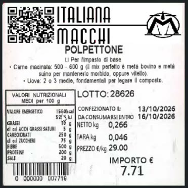
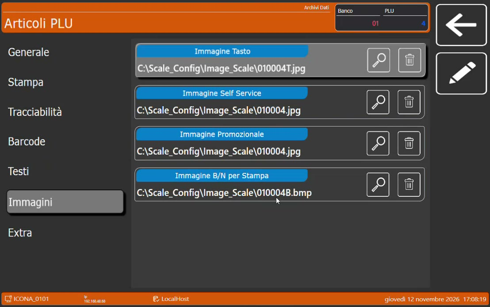
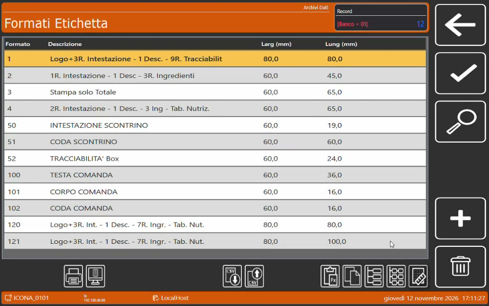
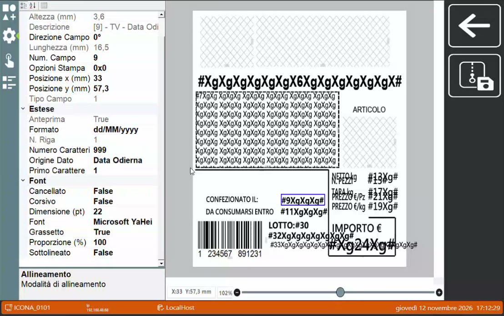

# Etichette parlanti e immagini

## Obiettivo

Conoscere l'**etichettatura al volo** della bilancia Icona e le **etichette parlanti**, cioè con QR code che rimandano a contenuti aggiornabili, e sapere dove si impostano le immagini e i campi del formato etichetta.

## Prerequisiti

- Bilancia Icona con formati etichetta configurati.
- Lotti disponibili sulla bilancia ([Vendita al banco con il lotto](vendita-bilancia.md)).

## Etichettare al volo

La bilancia ha una modalità di **etichettatura avanzata**, da usare quando le etichette da produrre sono molte. Ma si può etichettare anche **al volo**, senza cambiare modalità: è il caso del take-away, la vaschetta preparata e messa momentaneamente nel banco mentre si lavora.

1. Seleziona l'articolo.
2. Scegli il **lotto** di tracciabilità o di produzione.
3. Invece dell'operatore di vendita, tocca l'operatore destinato all'**etichetta**.

La bilancia stampa l'etichetta con il layout grafico previsto.

!!! info "Senza cambiare la carta"
    Se nella bilancia c'è un **rotolo adesivo**, non serve togliere la carta e mettere quella per etichette: il rotolo adesivo stampa direttamente il layout grafico dell'etichetta.

Le informazioni di tracciabilità si comunicano al cliente sul totem, sulla lavagnetta o etichetta elettronica, oppure su un'**etichetta cartacea**: questa è la terza via.

## Che cos'è un'etichetta parlante

Oltre ai dati di tracciabilità, tara, peso netto e prezzo, l'etichetta può portare uno o più **QR code**, che il cliente inquadra con il telefono.

*Etichetta di un taglio: un QR code nell'intestazione e uno riferito all'articolo.*

| QR code | Esempi di utilizzo |
|---------|--------------------|
| **Dell'intestazione** | Rimando a una pagina video che racconta la storia dell'azienda |
| **Dell'articolo** | Dati nutrizionali aggiuntivi del prodotto, oppure un video con i consigli di preparazione (per esempio come cucinare la fiorentina) |

*Etichetta della fiorentina: il QR code dell'articolo porta ai consigli di preparazione.*

!!! tip "Perché \"parlante\""
    Il contenuto dietro al QR code si può cambiare **in qualsiasi momento**: collegandolo a un altro indirizzo si modifica, di fatto, anche un'etichetta già uscita dal negozio, senza alcuno sforzo. È un valore aggiunto da proporre: molte attività etichettano anche per conto terzi.

## L'etichetta di un preparato

Per un prodotto lavorato, come il polpettone, serve un layout diverso. Non si riportano i dati della mezzena ma:

- il **lotto di produzione**;
- le date (confezionato il, da consumarsi entro);
- gli **ingredienti** e gli eventuali allergeni;
- la **tabella dei valori nutrizionali**, che è obbligatoria.

*Etichetta di un preparato.*

## Dove si imposta

### Le immagini dell'articolo

Sulla bilancia, nell'anagrafica **Articoli PLU**, la sezione **Immagini** permette di agganciare all'articolo più immagini, una per ogni ambito di utilizzo della bilancia: **Immagine Tasto**, **Immagine Self Service**, **Immagine Promozionale** e **Immagine B/N per Stampa**. Quest'ultima è quella agganciata in fase di stampa: nell'etichetta parlante è il QR code dell'articolo.

*La sezione Immagini dell'articolo sulla bilancia.*

L'immagine per la stampa è un file **BMP monocromatico**: la stampante della bilancia è termica e stampa in bianco e nero. Gli altri dati dell'articolo non si inseriscono a mano sulla bilancia: arrivano da HyperStore o da Hyperetail e si aggiornano da soli quando cambiano.

### Aggiornare i QR code dal PC

Le immagini stanno in una cartella della bilancia raggiungibile in rete. Dal PC di back office, dove c'è HyperStore, basta creare un collegamento a quella cartella. A quel punto ci sono due modi per cambiare ciò che l'etichetta comunica:

- **sovrascrivere il file** dell'immagine: le etichette stampate da quel momento portano il nuovo QR code;
- lasciare lo stesso QR code e **cambiare il contenuto della pagina** a cui rimanda: si aggiornano così anche le etichette già stampate.

### Il formato etichetta

Nei **Formati Etichetta** l'etichetta si disegna liberamente, non solo a tabelle ma anche in modo grafico.

*I formati etichetta disponibili sulla bilancia.*

*L'editor: a sinistra le proprietà del campo selezionato, a destra l'anteprima dell'etichetta.*

| Elemento | Possibilità |
|----------|-------------|
| **Campo immagine** | Può prendere l'immagine agganciata al PLU, oppure un'altra immagine presente sulla bilancia |
| **Campo data** | L'origine può essere la **data odierna** oppure la **data di produzione**, che può essere diversa; il formato della data è modificabile |
| **Font** | Si possono usare i font di Windows |

L'emissione dell'etichetta è istantanea: la bilancia monta una stampante ad alta velocità.

## Immagini e video promozionali

Dalla stessa postazione si gestiscono anche i contenuti multimediali dell'ecosistema, con un semplice copia e incolla dei file:

- le immagini e i video pubblicitari sul **monitor lato cliente** della bilancia (in 4K), con i relativi palinsesti;
- le immagini sul **totem**;
- le immagini sul **monitor eliminacode**.

!!! tip "Argomento di vendita"
    Il cliente è dentro il negozio: è quello il momento per raggiungerlo con contenuti pubblicitari e promozionali. L'esercente può gestire tutto in autonomia.
