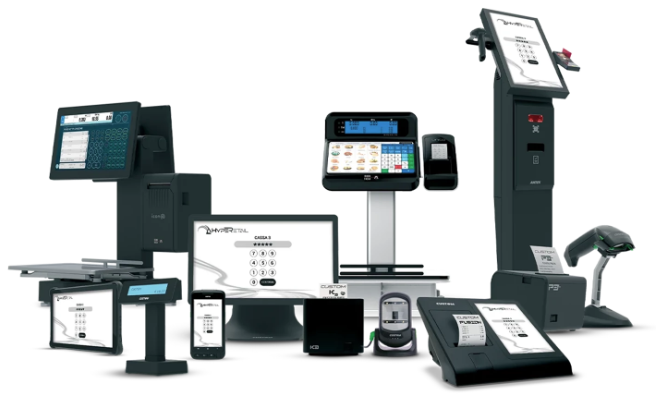
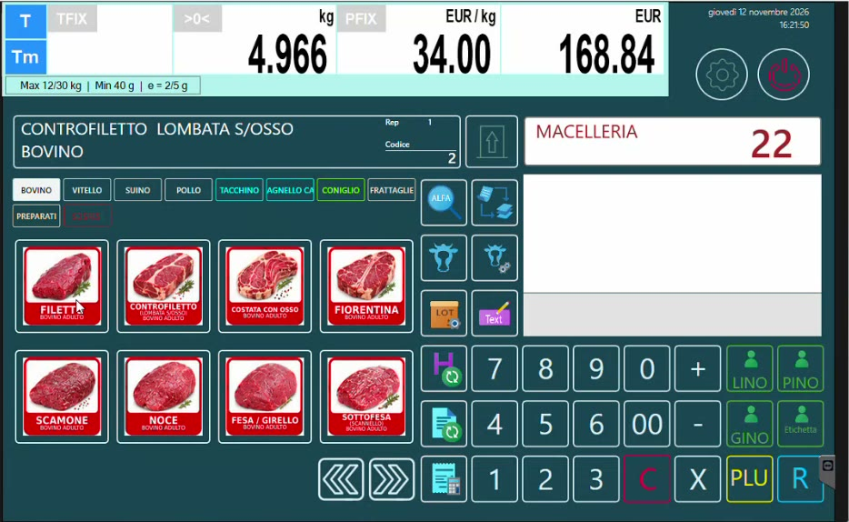

# Tracciabilità, lotti e trasformazioni con Hyperetail e bilancia Icona

  
  

Scopri la soluzione software **Hyperetail** sul sito istituzionale Custom: [custom.biz - Hyperetail](https://www.custom.biz/software/suites/hyperetail-general-store).

Questa guida segue una macelleria dall'arrivo della **mezzena** fino alla vendita al banco: il lotto tracciabile viene caricato una sola volta in **HyperStore**, arriva da solo sulla **bilancia Icona** e resta ricostruibile anche dopo le lavorazioni (macinato, polpette, polpettone).

*La schermata di vendita della bilancia Icona del banco macelleria.*

---

## Che cosa saprai fare al termine

- Spiegare a un macellaio la differenza tra **tracciabilità** e **lotto di produzione**.
- Configurare in HyperStore **banchi, bilance e definizioni tracciabili**.
- Caricare una mezzena con il suo lotto e venderne i tagli dalla bilancia Icona con lo **scarico del peso** del lotto.
- Creare **modelli di trasformazione** (ricette), eseguire una trasformazione e assegnare il **lotto di produzione**.
- Risalire dal prodotto finito ai **lotti di ogni ingrediente**.
- Presentare le novità della bilancia Icona: etichette parlanti, conti sospesi, promozioni a soglia di peso.

!!! warning "Tracciabilità e lotto di produzione: non confonderli"
    Vengono chiamati allo stesso modo ("lotti"), ma seguono dinamiche diverse. La **tracciabilità** riguarda i dati di origine che accompagnano la carne acquistata; il **lotto di produzione** identifica ciò che il negozio lavora in proprio. Vedi [Concetti e obblighi](tracciabilita-carni.md).

---

## L'ecosistema in gioco

| Componente | Ruolo nel flusso |
|------------|------------------|
| **HyperStore** | Back office: definizioni tracciabili, articoli, carichi, modelli di trasformazione, trasformazioni, rintracciabilità. È il cuore di questa guida. |
| **LiveRetail** | Modulo necessario per collegare HyperStore alle bilance. |
| **Bilancia Icona** | Vendita al banco con scelta del lotto e controllo del peso, etichettatura, conti sospesi, promozioni. Riceve i dati da HyperStore in tempo reale. |
| **DeLine** e **DeLine Ticket** | Totem per il numero e per la consultazione dei dati tracciabili, monitor eliminacode con più code. |
| **Hyperetail** | Cassa: legge il QR code dello scontrino della bilancia e può chiamare a sua volta le code. Qui è solo l'ultimo anello. |

---

## Struttura del portale

### Tracciabilità delle carni

| Pagina | Contenuto |
|--------|-----------|
| [Concetti e obblighi](tracciabilita-carni.md) | Mezzena, dati di origine, obbligo di informare il consumatore |
| [Normativa europea e italiana](normativa-carni-bovine.md) | Regolamenti CE, decreti italiani, indicazioni obbligatorie in etichetta, controlli |
| [Banchi e bilance in HyperStore](banchi-bilance.md) | Gruppi Bilance - Banchi e anagrafica Bilance |
| [Definizioni tracciabili](definizioni-tracciabili.md) | Estese, ridotte e precompilate; bovino, avicolo, suino |
| [Articoli: mezzena, tagli e macinato](articoli-mezzena-tagli.md) | Come impostare i tre tipi di articolo |
| [Carico della mezzena e del lotto](carico-mezzena.md) | Bolla o fattura, peso, lotto, dati tracciabili |
| [Vendita al banco con il lotto](vendita-bilancia.md) | Scelta del lotto su Icona e scarico del peso |

### Lotti di produzione e trasformazioni

| Pagina | Contenuto |
|--------|-----------|
| [Dalla mezzena al macinato](trasformazione-macinato.md) | La prima trasformazione e il lotto di produzione |
| [Prodotto finito e ingredienti](prodotto-finito-ingredienti.md) | Fornitori, prodotto finito (polpettone), ingredienti |
| [Carico degli ingredienti da CSV](carico-ingredienti.md) | Import con tracciato, lotti e scadenze del fornitore |
| [Modelli di trasformazione](modelli-trasformazione.md) | La ricetta e il costo di produzione |
| [Eseguire una trasformazione](eseguire-trasformazione.md) | Quantità, lotti di origine, lotto e scadenza del prodotto |
| [Rintracciabilità dei lotti](rintracciabilita-lotti.md) | Lista trasformazioni e mastrino del prodotto |

### Novità bilancia Icona

| Pagina | Contenuto |
|--------|-----------|
| [Etichette parlanti e immagini](etichette-parlanti.md) | Etichettatura al volo, QR code, immagini e formato etichetta |
| [Lotti tracciabili dalla bilancia](lotti-da-bilancia.md) | Gestire il lotto in autonomia, senza gestionale |
| [Conti sospesi e comande](conti-sospesi.md) | Conti parcheggiati, più operatori, stampa della comanda |
| [Promozioni a soglia di peso](promozioni-a-soglia.md) | Taglio prezzo e sconto percentuale per fasce di peso |

### DeLine e cassa

| Pagina | Contenuto |
|--------|-----------|
| [Totem, code e cassa](totem-eliminacode.md) | Totem informativo, monitor eliminacode, chiamata dalla cassa |

---

## Prerequisiti

- **HyperStore** con il modulo **LiveRetail** attivo.
- Una **bilancia Icona** in rete: al momento la tracciabilità gestita da HyperStore è compatibile **solo con Icona**.
- Bilancia già configurata (banchi, articoli, tastiera).

## Documenti scaricabili

- [Circolare sui controlli dell'etichettatura delle carni bovine (PDF)](assets/resources/Circ_carni_bovine.pdf), riassunta nella pagina [Normativa europea e italiana](normativa-carni-bovine.md).

!!! note "Dati di esempio"
    Le schermate provengono da archivi dimostrativi: nomi di fornitori, lotti e prezzi che compaiono nelle immagini sono dati di esempio.
