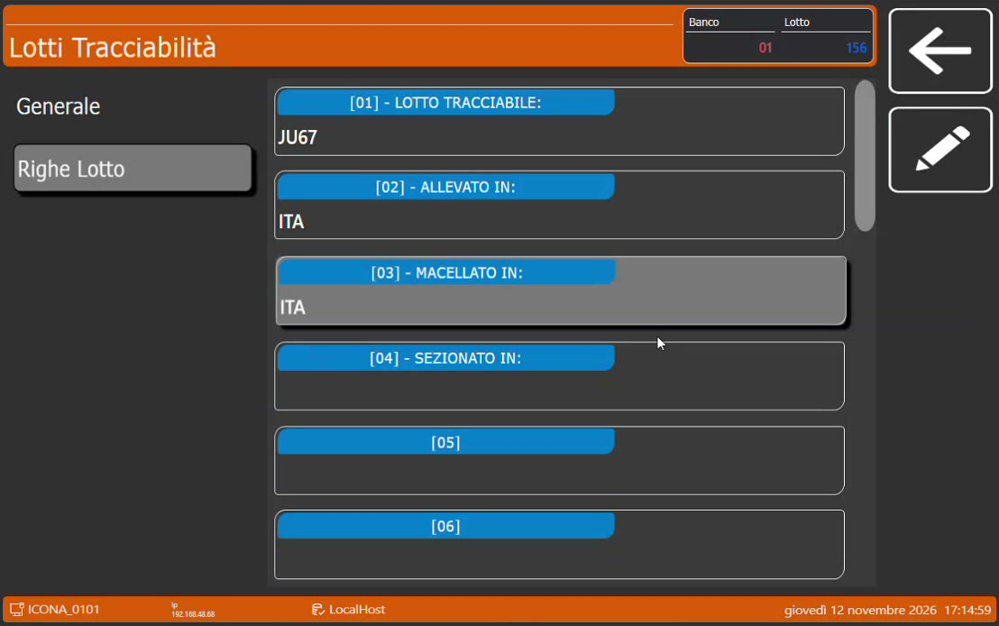

# Lotti tracciabili dalla bilancia

**Target:** rivenditore / tecnico installatore.

## Obiettivo

Sapere che la bilancia Icona può gestire la tracciabilità **in autonomia**, inserendo il lotto direttamente dalla schermata di vendita, e come proporre al cliente un percorso che parte dalla sola bilancia.

## Un ecosistema modulare

Il sistema è **modulare**: si può vendere al cliente la sola bilancia Icona e costruire il resto intorno, quando serve. Partire dalla bilancia è il percorso consigliato a chi inizia, perché è la bilancia che permette poi di espandersi: verso l'eliminacode e verso la gestione completa della tracciabilità.

Senza gestionale le operazioni sono più **manuali**, ma la tracciabilità si gestisce comunque.

## Passaggi

1. Dalla schermata di vendita tocca il tasto dei **lotti**.
2. Premi **+** per aggiungere un nuovo lotto: la bilancia gli assegna un numero che lo identifica.
3. Aggancia la **definizione** di tracciabilità, scegliendola tra quelle disponibili.
4. Indica il **peso** del lotto, se vuoi gestirne la giacenza.
5. Nelle **Righe Lotto** rispondi alle domande della definizione: lotto tracciabile, allevato in, macellato in, sezionato in.

*Le righe del lotto compilate direttamente sulla bilancia.*

!!! note "Definizioni create in HyperStore"
    Le definizioni inviate da HyperStore sono utilizzabili anche per i lotti creati a mano sulla bilancia. Le stesse definizioni, in alternativa, si possono creare direttamente sulla bilancia.

!!! warning "I valori predefiniti non vengono proposti"
    I valori predefiniti di una definizione precompilata vengono proposti al carico in HyperStore. Creando il lotto dalla bilancia le risposte vanno **compilate a mano**.

## Verifica

- Il nuovo lotto compare nell'elenco proposto quando si vende un articolo tracciato.
- Dopo una pesata il peso del lotto diminuisce.

## Che cos'altro fa la bilancia da sola

Anche senza un gestionale collegato, la bilancia Icona gestisce:

- le [promozioni a soglia di peso](promozioni-a-soglia.md), con una sorta di volantino;
- i [conti sospesi](conti-sospesi.md) con la stampa delle comande.

Può quindi diventare, a tutti gli effetti, un **micro sistema gestionale**.
