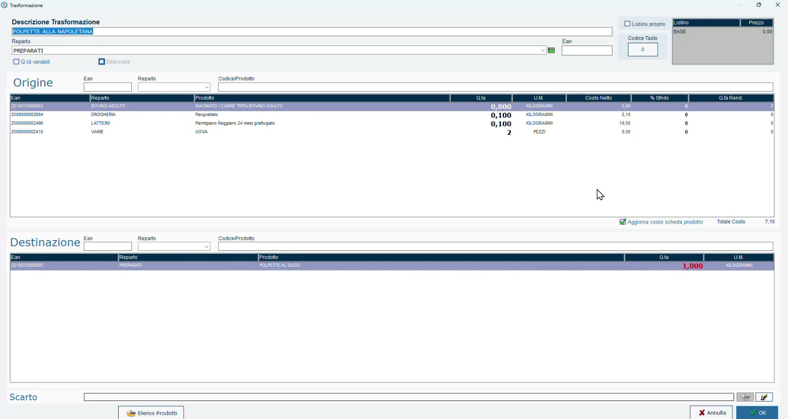

# Modelli di trasformazione

## Obiettivo

Definire la **ricetta** di un preparato: quali ingredienti, in che quantità, per ottenere quale prodotto. Il modello si crea una volta sola e fornisce anche il **costo di produzione**.

## Prerequisiti

- Prodotto finito e ingredienti presenti in anagrafica ([Prodotto finito e ingredienti](prodotto-finito-ingredienti.md)).

## Passaggi

1. Apri **Modelli Trasformazioni** e premi **Aggiungi**.
2. Compila la **Descrizione Trasformazione** (nell'esempio *POLPETTE ALLA NAPOLETANA*) e il **Reparto**.
3. Nella sezione **Origine** aggiungi gli ingredienti, indicando per ciascuno la quantità necessaria a produrre la quantità di destinazione.
4. Nella sezione **Destinazione** indica il prodotto ottenuto e la quantità (nell'esempio 1 kg).
5. Conferma con **OK**: il modello compare nell'elenco dei modelli.

### L'esempio: polpette alla napoletana

Per ottenere **1 kg** di prodotto:

| Ingrediente (origine) | Quantità | Unità |
|-----------------------|----------|-------|
| Macinato di bovino adulto | 0,800 | Kg |
| Pangrattato | 0,100 | Kg |
| Parmigiano Reggiano grattugiato | 0,100 | Kg |
| Uova | 2 | Pezzi |

*Il modello completo: in alto gli ingredienti, in basso il prodotto di destinazione, a destra il totale del costo.*

!!! note "Unità di misura diverse"
    Ogni ingrediente usa l'unità definita nella sua anagrafica: chilogrammi per macinato e pangrattato, **pezzi** per le uova.

!!! note "Destinazione in rosso"
    Finché il prodotto non è stato ancora prodotto, la quantità di destinazione è evidenziata in rosso: si è ancora nella fase di definizione della ricetta.

## Il costo di produzione

Per ogni riga di origine il modello riporta il **costo netto** dell'ingrediente e, in basso, il **Totale Costo** della ricetta (nell'esempio 7,16 per un chilo di preparato).

Non è un costo fisso ma **dinamico**: viene calcolato con gli ultimi prezzi dei fornitori. Man mano che i carichi cambiano i prezzi di acquisto, il programma segnala che il prodotto sta costando di più e permette di adeguare il prezzo di vendita. È, di fatto, un **food cost interno**.

!!! tip "Argomento di vendita"
    Con i modelli di trasformazione si può gestire un intero banco gastronomia di preparati, sapendo per ognuno quanto costa produrlo.

## Verifica

- Il modello compare nell'elenco di **Modelli Trasformazioni**.
- Il **Totale Costo** riporta il costo della ricetta calcolato con gli ultimi prezzi di acquisto.

Il passo successivo è la produzione vera e propria: [Eseguire una trasformazione](eseguire-trasformazione.md).
