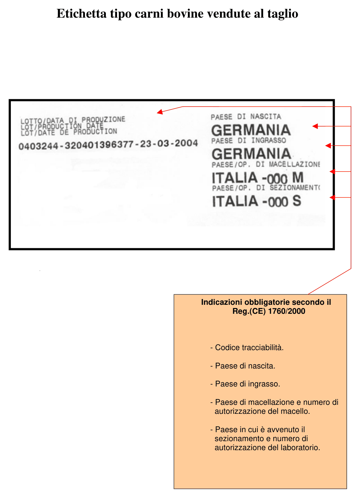
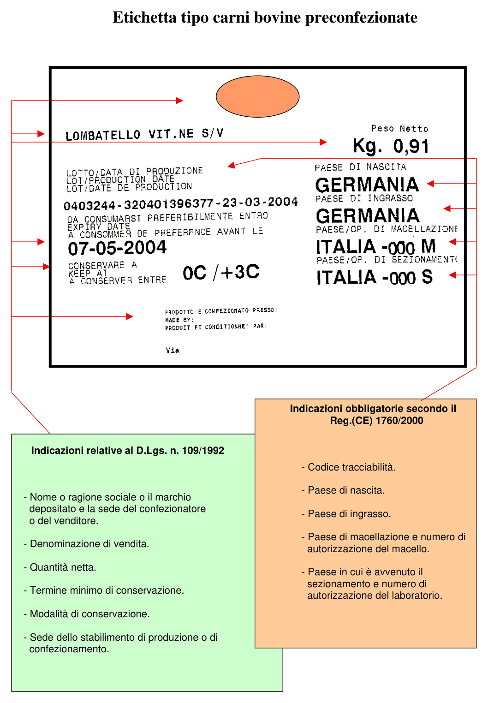
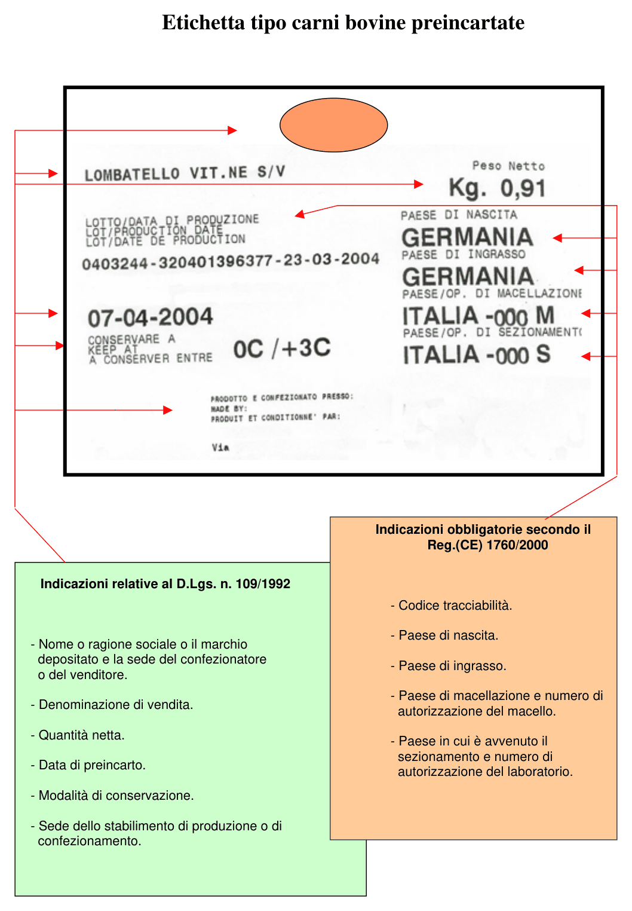
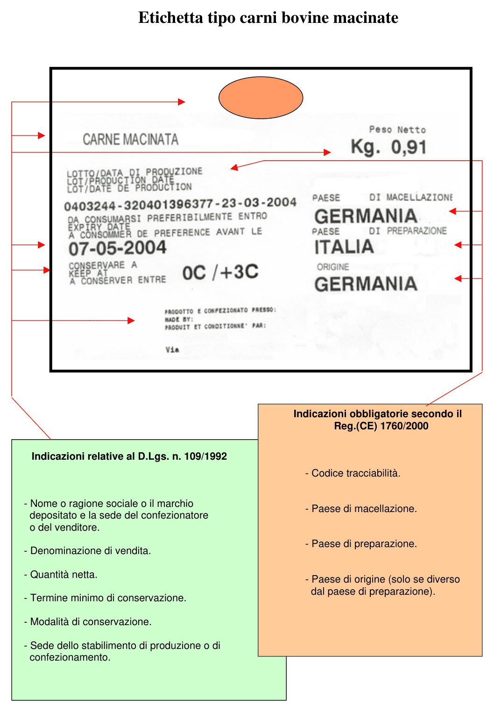

<!-- categoria assegnata per inferenza: verificare -->

# Normativa europea e italiana sull'etichettatura delle carni bovine

Gli obblighi di tracciabilità descritti in questa guida derivano da regolamenti europei e da decreti italiani. Questa pagina riassume la circolare del **30 marzo 2004** (prot. 21167) sui **controlli dell'etichettatura delle carni bovine**: è il documento che indica agli uffici di controllo che cosa verificare nei punti vendita, ed è quindi anche l'elenco di ciò che una macelleria deve avere in ordine.

[Scarica la circolare (PDF)](assets/resources/Circ_carni_bovine.pdf)

!!! warning "Documento del 2004: verifica la normativa vigente"
    La circolare cita le norme in vigore alla data di emissione e riguarda **solo le carni bovine**. Da allora il quadro è cambiato: in particolare la disciplina generale dell'etichettatura degli alimenti del D.Lgs. 109/1992 è stata in seguito superata dal Reg. (UE) n. 1169/2011 sulle informazioni sugli alimenti ai consumatori. Usa questa pagina come riferimento di base e verifica sempre le disposizioni aggiornate prima di dare indicazioni a un cliente.

## Le norme di riferimento

| Norma | Livello | Che cosa riguarda |
|-------|---------|-------------------|
| **Reg. (CE) n. 1760/2000** | Europeo | Etichettatura delle carni bovine e dei prodotti a base di carni bovine. L'articolo 12 individua i prodotti soggetti all'obbligo; il regolamento fissa le indicazioni obbligatorie in etichetta |
| **Reg. (CE) n. 1825/2000** | Europeo | Citato insieme al 1760/2000 tra i regolamenti sull'etichettatura delle carni bovine e dei prodotti a base di carni bovine |
| **D.Lgs. 29 gennaio 2004, n. 58** | Italiano | Disposizioni sanzionatorie per le violazioni dei due regolamenti europei |
| **D.Lgs. n. 109/1992** | Italiano | Indicazioni generali da riportare in etichetta sui prodotti preconfezionati, preincartati e macinati: denominazione di vendita, quantità netta, conservazione, confezionatore |

La disciplina comunitaria ha una **duplice finalità**:

- assicurare la massima **trasparenza** nella commercializzazione, dando al consumatore informazioni più precise;
- garantire un **sistema di tracciabilità**.

## A quali prodotti si applica

Sono soggetti all'obbligo di etichettatura (art. 12 del Reg. 1760/2000):

- tutta la **carne bovina fresca, refrigerata o congelata** (codici doganali 0201 e 0202);
- i **pilastri del diaframma** (onglets) e il **diaframma** (hampes), freschi o congelati (codici doganali 0206 1095 e 0206 2991);
- la **carne macinata**.

Sono **esclusi**:

- le **preparazioni a base di carne**, intese come carni a cui sono stati aggiunti ingredienti diversi dal sale;
- le **frattaglie** non comprese nelle voci doganali indicate sopra.

!!! note "Macinato e preparati nella guida"
    Il **macinato** rientra nell'obbligo e ha un'etichetta tipo dedicata. Polpette e polpettone, che contengono altri ingredienti, sono invece preparazioni: in questa guida sono gestiti con il **lotto di produzione** e con un'etichetta diversa. Vedi [Dalla mezzena al macinato](trasformazione-macinato.md) e [Etichette parlanti e immagini](etichette-parlanti.md).

## Dove avvengono i controlli

I controlli si svolgono nei punti vendita che commercializzano, lavorano ed etichettano le carni bovine per la vendita diretta al consumatore finale:

- punti vendita con preparazioni di carne **preconfezionate o preincartate**;
- punti vendita di carne venduta **al taglio**.

In pratica: **grande distribuzione organizzata** e **macellerie**. I punti precedenti della filiera, cioè macelli e laboratori di sezionamento, sono seguiti dai Servizi sanitari nazionali.

## Che cosa viene verificato

1. L'**autorizzazione sanitaria**.
2. La presenza dell'**etichetta obbligatoria** e delle relative informazioni:
    - codice di rintracciabilità;
    - **Nato in**: Paese di nascita;
    - **Ingrassato in**: Paese o Paesi di allevamento;
    - **Macellato in**: Paese di macellazione e numero di approvazione del macello;
    - **Sezionato in**: Paese di sezionamento e numero di approvazione del laboratorio di sezionamento.
3. L'adozione di un **sistema di tracciabilità** idoneo per l'identificazione della carne.
4. L'eventuale presenza in etichetta di **informazioni facoltative** (presenza del codice di autorizzazione ministeriale).
5. La corrispondenza delle indicazioni in etichetta con il **sistema di registrazione** adottato e con i relativi riscontri (**bolle di consegna e fatture**), oltre che con l'etichetta che accompagnava il prodotto, eventualmente prima delle lavorazioni effettuate nel punto vendita.

!!! info "Controlli a sondaggio"
    La verifica del punto 5 viene fatta a sondaggio, su **almeno il 10%** dei prodotti controllati. Sempre a sondaggio viene verificato che le informazioni facoltative in etichetta corrispondano a quelle approvate nel relativo disciplinare di etichettatura.

## Le indicazioni obbligatorie per tipo di vendita

La circolare allega quattro etichette tipo. Le indicazioni cambiano secondo il modo in cui la carne viene venduta.

### Indicazioni del Reg. (CE) 1760/2000

| Indicazione | Al taglio | Preconfezionate | Preincartate | Macinate |
|-------------|:---------:|:---------------:|:------------:|:--------:|
| Codice di tracciabilità | SI | SI | SI | SI |
| Paese di nascita | SI | SI | SI | - |
| Paese di ingrasso | SI | SI | SI | - |
| Paese di macellazione | SI, con numero di autorizzazione del macello | SI, con numero di autorizzazione del macello | SI, con numero di autorizzazione del macello | SI |
| Paese di sezionamento e numero di autorizzazione del laboratorio | SI | SI | SI | - |
| Paese di preparazione | - | - | - | SI |
| Paese di origine | - | - | - | Solo se diverso dal Paese di preparazione |

### Indicazioni del D.Lgs. 109/1992

Si aggiungono a quelle del regolamento per le carni preconfezionate, preincartate e macinate. L'etichetta tipo della carne venduta al taglio riporta solo le indicazioni del regolamento.

| Indicazione | Preconfezionate | Preincartate | Macinate |
|-------------|:---------------:|:------------:|:--------:|
| Nome o ragione sociale o marchio depositato e sede del confezionatore o del venditore | SI | SI | SI |
| Denominazione di vendita | SI | SI | SI |
| Quantità netta | SI | SI | SI |
| Termine minimo di conservazione | SI | - | SI |
| Data di preincarto | - | SI | - |
| Modalità di conservazione | SI | SI | SI |
| Sede dello stabilimento di produzione o di confezionamento | SI | SI | SI |

### Le etichette tipo

*Carni bovine vendute al taglio.*

*Carni bovine preconfezionate.*

*Carni bovine preincartate.*

*Carni bovine macinate.*

## Contestazioni e sanzioni

Secondo l'articolo 9 del D.Lgs. 58/2004, l'organo che riceve il rapporto sulle violazioni accertate, quando il trasgressore non paga in misura ridotta, è la **Regione** o la **Provincia autonoma**: a queste autorità compete erogare le sanzioni amministrative.

## Dalla norma al software

Le verifiche previste dalla circolare corrispondono a operazioni descritte in questa guida.

| Che cosa viene verificato | Dove si gestisce |
|---------------------------|------------------|
| Informazioni obbligatorie in etichetta | [Definizioni tracciabili](definizioni-tracciabili.md): ogni informazione è un campo della definizione, che può essere reso obbligatorio |
| Sistema di tracciabilità per identificare la carne | [Carico della mezzena e del lotto](carico-mezzena.md) e [Vendita al banco con il lotto](vendita-bilancia.md) |
| Riscontro con bolle di consegna e fatture | Il lotto nasce dal carico del documento del fornitore: [Carico della mezzena e del lotto](carico-mezzena.md) |
| Lavorazioni effettuate nel punto vendita | [Eseguire una trasformazione](eseguire-trasformazione.md) e [Rintracciabilità dei lotti](rintracciabilita-lotti.md) |
| Informazione al consumatore | [Etichette parlanti e immagini](etichette-parlanti.md) e [Totem, code e cassa](totem-eliminacode.md) |

!!! tip "I campi della definizione sono liberi"
    Se al cliente serve riportare un dato previsto dalla norma, per esempio il numero di approvazione del macello o del laboratorio di sezionamento, basta aggiungere un campo alla definizione tracciabile e decidere se inviarlo alla bilancia.
