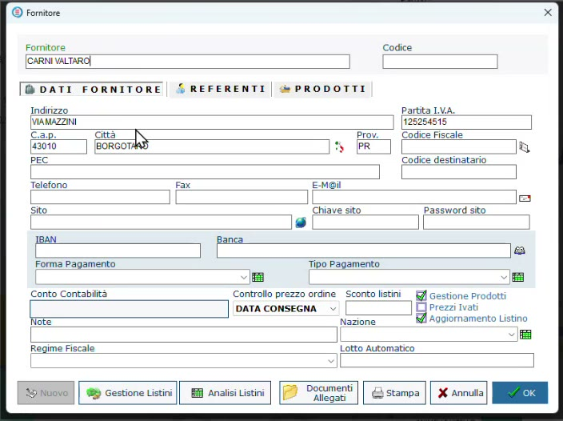
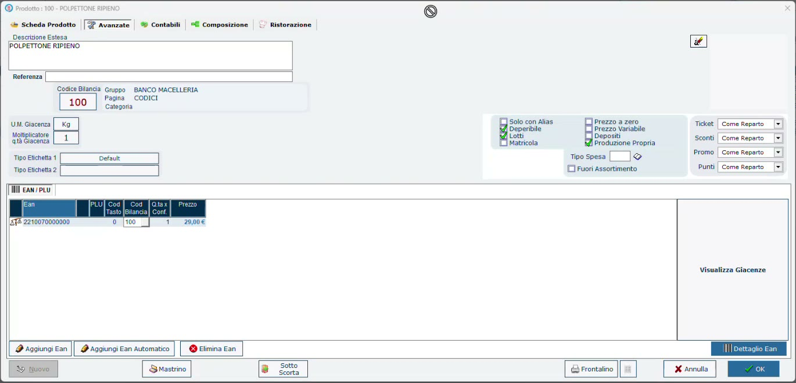
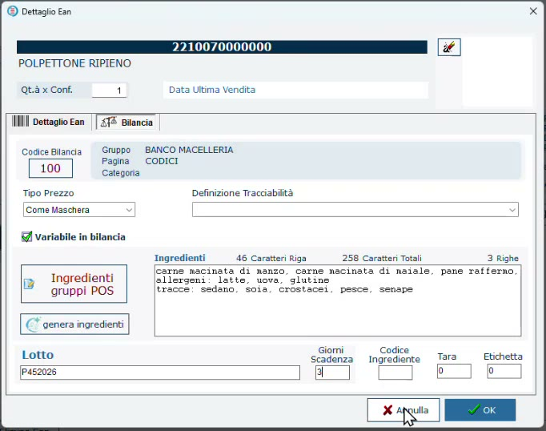

# Prodotto finito e ingredienti

## Obiettivo

Preparare le anagrafiche necessarie a una trasformazione di gastronomia: il **fornitore**, il **prodotto finito** (nell'esempio un polpettone ripieno) e gli **ingredienti**, distinguendo correttamente gli uni dagli altri.

## Prerequisiti

- HyperStore con il modulo **LiveRetail** (necessario per lavorare con le bilance).
- Banco e bilancia configurati ([Banchi e bilance in HyperStore](banchi-bilance.md)).

## Perché tracciare i preparati

Molte macellerie si stanno spostando verso il **prodotto trasformato**: sughi, polpette, polpettoni. Materia prima e ingredienti di cucina diventano un prodotto nuovo, che richiede a sua volta una tracciabilità.

La normativa vuole che si sia sempre in grado di ricostruire **con quale lotto di ogni ingrediente** è stato fatto un preparato: quale lotto di uova, quale lotto di macinato, perfino quale lotto di sale. Se un ingrediente dà un problema, bisogna poter risalire ai prodotti in cui è finito.

!!! info "Un obbligo, non una scelta"
    I controlli HACCP avvengono comunque. Oggi molti esercenti fanno questo lavoro a mano, compilando le schede di produzione; con il programma la rintracciabilità è reale e nasce durante il lavoro.

## Passaggi

### 1. Il fornitore

In **Anagrafiche → Fornitori** crea il fornitore da cui acquisti gli ingredienti. Nella scheda attiva:

- **Gestione Prodotti**;
- **Aggiornamento Listino**.

*Le due opzioni da attivare sono in basso a destra nella scheda Dati fornitore.*

### 2. Il prodotto finito

1. In **Prodotti** crea l'articolo, per esempio **POLPETTONE RIPIENO**, nel reparto dei preparati.
2. Imposta la vendita **a peso** (unità di misura Kg) e il prezzo al chilo sul listino base.
3. Assegna il **codice bilancia** (nell'esempio 100) e crea l'EAN con **Aggiungi Ean Automatico**.
4. Nella scheda **Avanzate** attiva **Deperibile**, **Lotti** e **Produzione Propria**: è un trasformato creato in negozio.

*Scheda Avanzate del prodotto finito.*

### 3. Ingredienti in etichetta e giorni di scadenza

1. Seleziona l'EAN e premi **Dettaglio Ean**, poi apri la scheda **Bilancia**.
2. Con **genera ingredienti** l'intelligenza artificiale propone l'elenco degli ingredienti del prodotto. È un suggerimento: correggi ciò che non corrisponde alla tua ricetta.
3. In **Giorni Scadenza** indica per quanti giorni il prodotto può restare nel banco (nell'esempio **3**).

*Gli ingredienti proposti e i giorni di scadenza: sono i dati che finiranno in etichetta.*

!!! warning "Controlla sempre il testo generato"
    L'elenco proposto è un suggerimento: nell'esempio la frutta a guscio proposta nella ricetta non c'è, e il testo si può modificare in qualsiasi momento. Ingredienti e allergeni in etichetta devono corrispondere al prodotto reale.

Il testo degli ingredienti è quello che comparirà sull'etichetta del preparato; i giorni di scadenza vengono usati per calcolare la scadenza a ogni produzione.

### 4. Gli ingredienti

Gli ingredienti (pangrattato, sale, uova, formaggio grattugiato) sono articoli come gli altri, con alcune differenze rispetto al prodotto finito:

| Impostazione | Prodotto finito | Ingrediente |
|--------------|-----------------|-------------|
| **Listino di vendita** | Sì: si vende al banco | Non necessario: il macellaio non lo rivende da solo |
| **Deperibile** e **Lotti** (Avanzate) | Attivi | Attivi |
| **Produzione Propria** (Avanzate) | Attivo | Non attivo |
| **Composizione** | Prodotto finito | Componente di un altro prodotto |
| **Unità di misura** | Kg | Kg oppure pezzi (per esempio le uova) |

!!! note "Un ingrediente può anche essere venduto"
    Nulla vieta che un ingrediente sia destinato anche alla vendita diretta: può avere una doppia funzione. Resta comunque un componente, ed è questo che lo rende utilizzabile nelle ricette.

## Verifica

- Il prodotto finito ha **Deperibile**, **Lotti** e **Produzione Propria** attivi.
- Ogni ingrediente ha **Deperibile** e **Lotti** attivi ed è indicato come componente.

## Errori comuni

| Problema | Causa probabile | Rimedio |
|----------|-----------------|---------|
| La trasformazione non chiede il lotto del prodotto finito | **Lotti** non attivo sul prodotto di destinazione | Attiva la gestione dei lotti nella scheda Avanzate |

Il passo successivo è caricare gli ingredienti con i loro lotti: [Carico degli ingredienti da CSV](carico-ingredienti.md).
