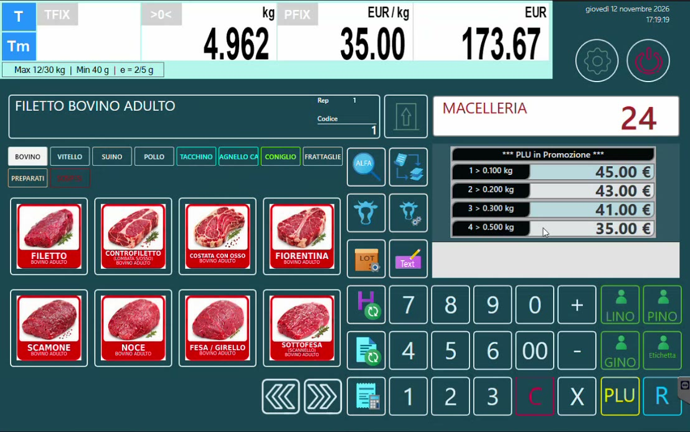
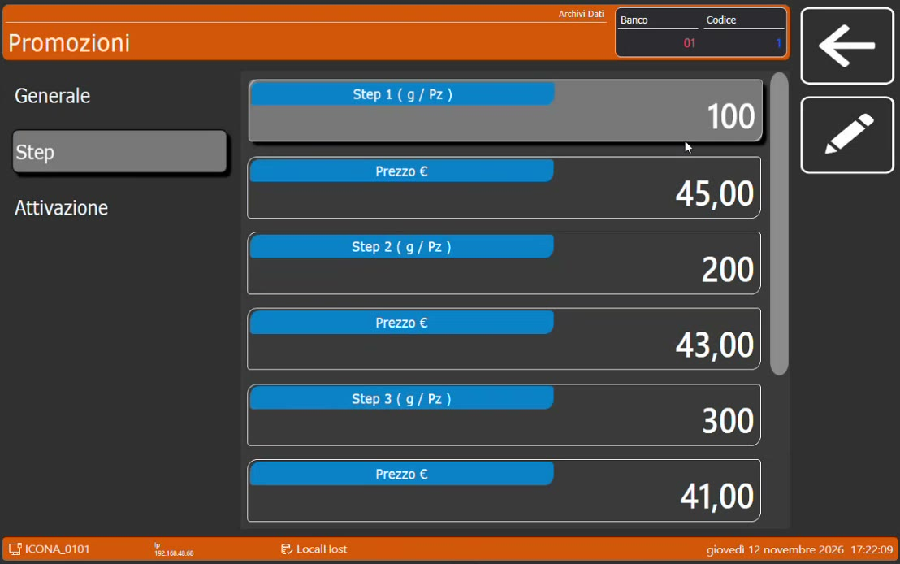

# Promozioni a soglia di peso

## Obiettivo

Configurare sulla bilancia Icona una promozione che cambia il prezzo, o applica uno sconto, **al superamento di determinate soglie di peso**, e mostrarla al cliente durante la vendita.

## Come appare in vendita

Toccando un articolo in promozione la bilancia, dopo la scelta del lotto, mostra la griglia **PLU in Promozione** con le soglie: l'operatore può informare il cliente che, prendendo un po' di più, il prezzo al chilo scende.

*Il filetto in promozione: quattro soglie, quattro prezzi al chilo.*

## Due tipi di promozione

| Tipo | Che cosa cambia | Esempio |
|------|-----------------|---------------------|
| **Taglio prezzo** | Il prezzo al chilo, a scaglioni | Filetto: oltre 100 g 45,00 €/kg; oltre 200 g 43,00; oltre 300 g 41,00; oltre 500 g 35,00 |
| **Percentuale di sconto** | Lo sconto applicato, a scaglioni | Fiorentina: oltre 100 g il 10%, poi 20%, 30% e 50% |

!!! info "Soglia di tolleranza"
    Per ogni promozione si imposta una **tolleranza in percentuale**, sopra o sotto la soglia, entro cui lo scaglione scatta comunque: avvicinandosi alla soglia il prezzo cambia.

Sullo scontrino gli articoli in promozione riportano il **prezzo di origine** e la **promozione applicata**.

## Passaggi

### 1. Crea la promozione

1. Sulla bilancia apri **Setup Bilancia → Archivi Dati → Promozioni**.
2. Crea la promozione e dalle un nome (nell'esempio *filetto*, con ID 1).
3. Nella sezione generale scegli il **tipo di promozione**: taglio prezzo oppure percentuale.
4. Nella sezione **Step** definisci gli scaglioni: per ognuno la soglia (in grammi o pezzi) e il prezzo.
5. Nella sezione **Attivazione** imposta il periodo di validità: **date**, **fascia oraria** e **giorni della settimana**.

*Gli scaglioni della promozione del filetto.*

### 2. Aggancia la promozione all'articolo

Nella scheda dell'articolo, sezione **Extra**, indica l'**ID della promozione** di cui fa parte. La stessa operazione vale per ogni articolo da mettere in promozione (nell'esempio il filetto e la fiorentina).

## Verifica

1. Tocca l'articolo in vendita: deve comparire la griglia **PLU in Promozione**.
2. Metti sul piatto un peso che supera una soglia: il prezzo al chilo deve scattare allo scaglione corrispondente.
3. Chiudi lo scontrino e controlla che riporti prezzo di origine e promozione.

## Da sapere

- Queste promozioni funzionano **anche senza un gestionale collegato**: la bilancia le gestisce da sola, come una sorta di volantino.
- Negli ecosistemi più complessi è previsto che le promozioni diventino gestibili a breve anche direttamente da **HyperStore**.

!!! tip "Non solo macellerie"
    Lo stesso meccanismo si adatta bene a **gelaterie** e **pasticcerie**: per esempio la vaschetta di gelato venduta a peso, con la tolleranza sulla soglia.
