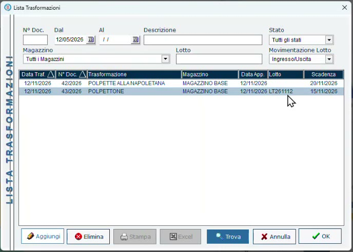
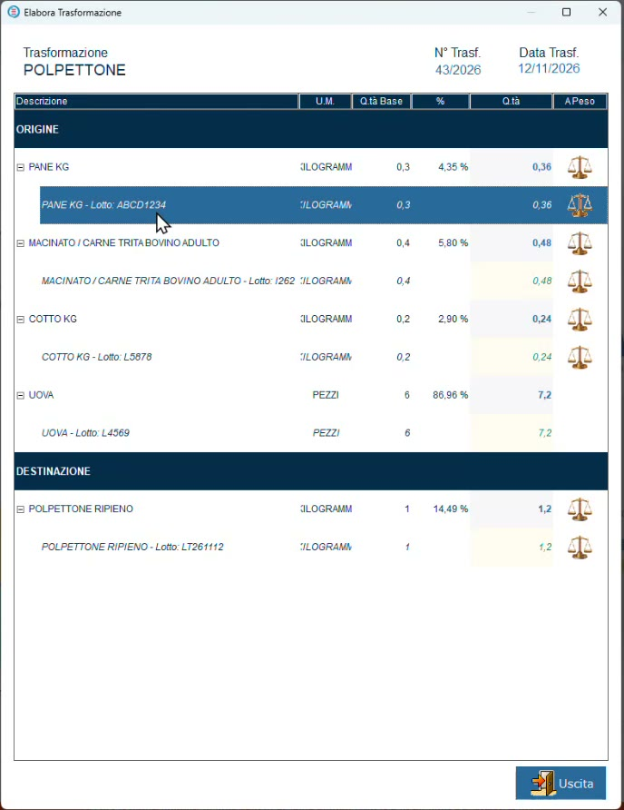
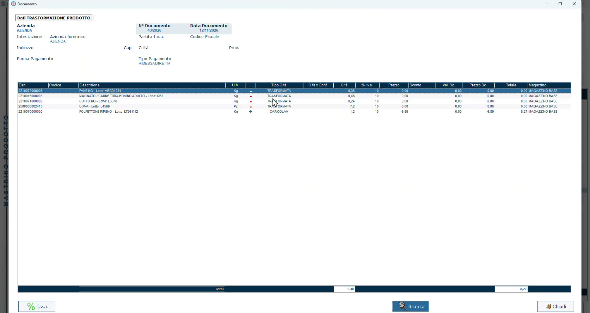

# Rintracciabilità dei lotti

**Target:** rivenditore / operatore di back office.

## Obiettivo

Partire da un prodotto finito e risalire ai **lotti di ogni ingrediente** usato per produrlo, dalla lista delle trasformazioni oppure dalla scheda del prodotto.

## Prerequisiti

- Almeno una trasformazione registrata con il lotto del prodotto finito ([Eseguire una trasformazione](eseguire-trasformazione.md)).

## Quando serve

- Per un **controllo**: le verifiche HACCP richiedono di dimostrare con quali lotti è stato fatto un prodotto.
- Per un **problema su un ingrediente**: bisogna sapere in quali preparati è finito quel lotto.
- Per rispondere a un **cliente** che chiede che cosa contiene ciò che acquista.

## Dalla lista delle trasformazioni

1. Apri **Trasformazioni**: compare la **Lista Trasformazioni**.
2. Usa i filtri per trovare la produzione: numero documento, intervallo di date, descrizione, stato, magazzino, **lotto**, movimentazione del lotto.
3. Ordina l'elenco per la colonna che ti serve, per esempio la data o la scadenza.
4. Fai **doppio clic** sulla trasformazione.

*La lista: per ogni produzione data, numero documento, magazzino, lotto e scadenza.*

Si apre il dettaglio della trasformazione, con le righe di **origine** e di **destinazione** e, per ognuna, il lotto.

*Il polpettone del lotto LT261112 e i lotti dei suoi ingredienti.*

Nell'esempio del webinar il polpettone **LT261112** risulta prodotto con:

| Ingrediente | Lotto |
|-------------|-------|
| Pane | ABCD1234 |
| Macinato di bovino adulto | I262 |
| Prosciutto cotto | L5878 |
| Uova | L4569 |

## Dalla scheda del prodotto: il mastrino

La rintracciabilità non è legata solo alle schede di trasformazione: è **intrinseca al prodotto**.

1. Apri la scheda del prodotto (per esempio il polpettone).
2. Premi **Visualizza Giacenze**: si apre il **mastrino**, con tutte le volte in cui l'articolo è stato movimentato in ingresso e in uscita.
3. In alto a sinistra puoi **filtrare per lotto**.
4. Fai **doppio clic** su un movimento: si apre il documento che lo ha generato, cioè la scheda di trasformazione.

*Il documento di trasformazione aperto dal mastrino.*

| Segno | Significato |
|-------|-------------|
| **+** | Carico del lotto di lavorazione: il prodotto finito entra a magazzino |
| **−** | Scarico degli ingredienti utilizzati dai rispettivi lotti |

!!! tip "Un punto di forza da mostrare"
    Il mastrino è un plus importante del programma: da un solo punto si vede tutta la storia dell'articolo e, con due clic, il lotto delle uova o di qualsiasi altro ingrediente usato.

## Verifica

Scegli un prodotto finito e controlla di saper rispondere, dalla lista delle trasformazioni o dal mastrino, alla domanda: *con quale lotto di ogni ingrediente è stato fatto?*
