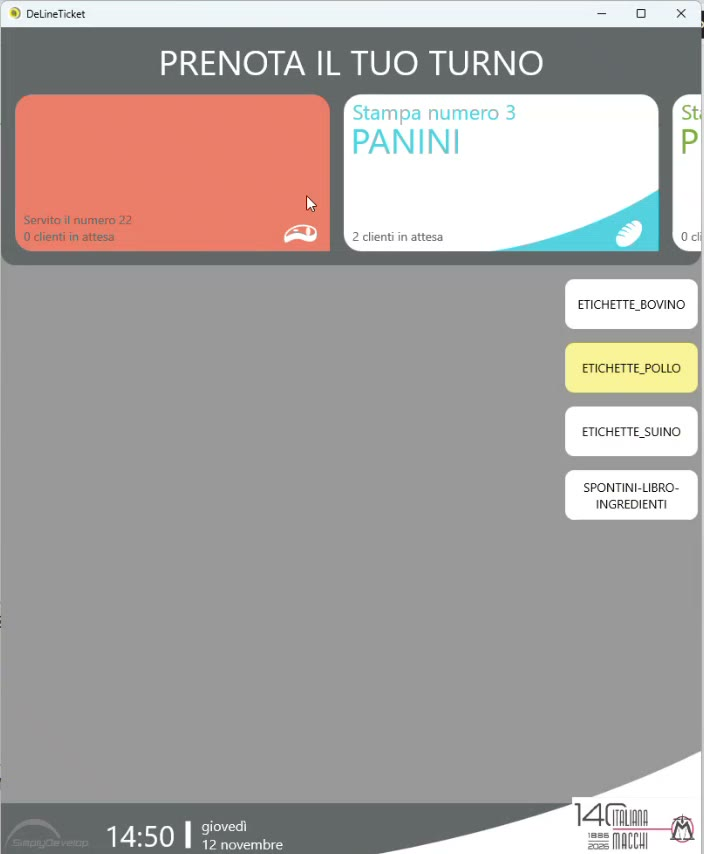
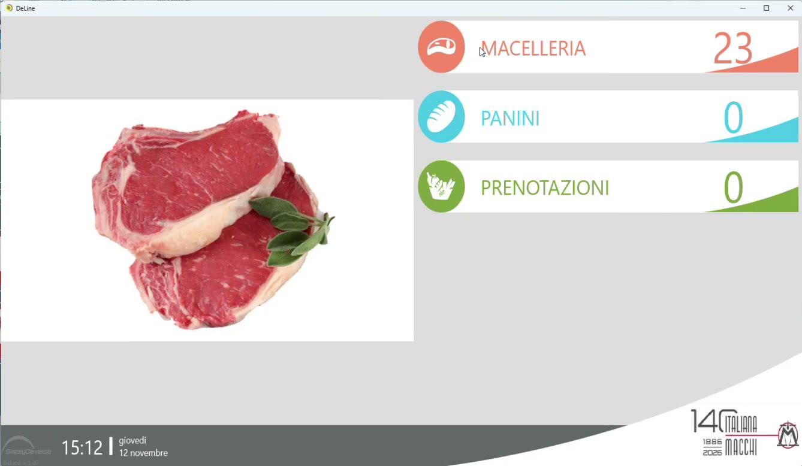
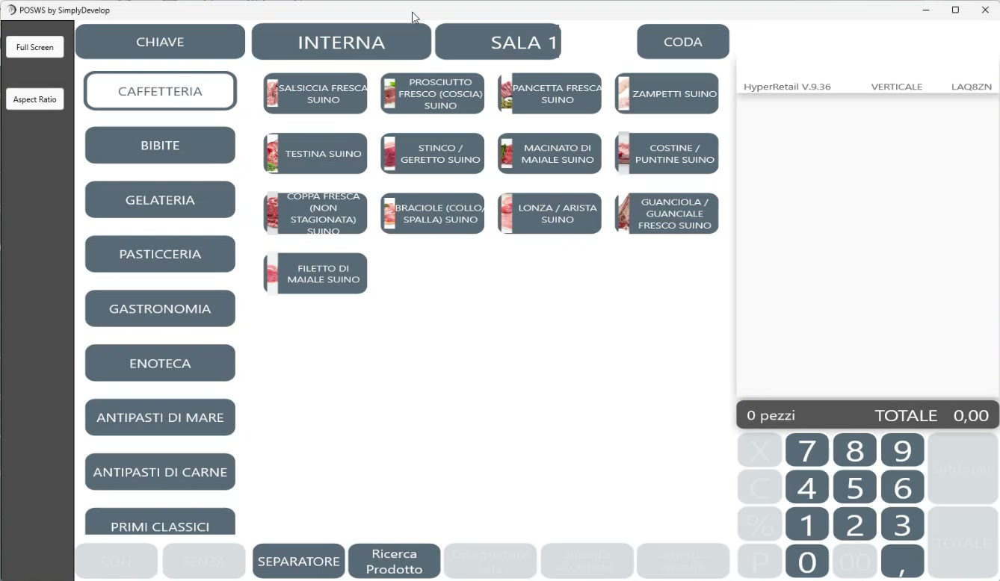

# DeLine: totem, code e cassa

**Target:** rivenditore.

## Obiettivo

Conoscere il ruolo di **DeLine** e **DeLine Ticket** nell'ecosistema della macelleria: il totem che informa il cliente, il monitor che chiama i numeri e la cassa Hyperetail che gestisce le proprie code.

## Il totem: non solo il numero

Il cliente che entra in macelleria trova il totem **DeLine Ticket**: prende il numero e si mette in coda. Ma il totem smette di servire solo a questo e diventa un **veicolo di informazione**:

- mostra i **dati di tracciabilità** dei lotti in vendita in quel momento, gestiti in automatico dal software;
- può mostrare il **libro ingredienti**.

In questo modo l'esercente assolve l'obbligo di informare il consumatore senza lavagnette da aggiornare a mano (vedi [Concetti e obblighi](tracciabilita-carni.md)).

*Il totem: in alto le code, a destra i pulsanti per consultare tracciabilità e libro ingredienti.*

## Il monitor eliminacode

Quando l'operatore chiama il cliente successivo dalla bilancia, il numero viene proiettato sul **monitor esterno** e si aggiorna in tempo reale. Il monitor può essere gestito da un mini PC o da un dispositivo Windows o Android.

Sullo stesso monitor convivono **più code**, ognuna con il proprio contatore, insieme alle immagini promozionali.

*Tre code sullo stesso monitor: banco macelleria, panini, prenotazioni.*

## Anche la cassa chiama

Le code non sono chiamate solo dalla bilancia. Anche la cassa **Hyperetail** è un terminale che può chiamare una coda: mentre il banco macelleria chiama i propri numeri, la cassa chiama i **panini pronti** o le **prenotazioni**, che seguono code separate.

*La cassa Hyperetail: in alto il pulsante CODA.*

Alla cassa, inoltre:

- si legge il **QR code** dello scontrino emesso dalla bilancia e lo scontrino viene "esploso" con il dettaglio degli articoli;
- l'interfaccia è **multipiattaforma** (Windows e Android) e ampiamente personalizzabile nella grafica.

## L'argomento commerciale: un unico ecosistema

Presi singolarmente, ogni prodotto ha i suoi concorrenti: la stampante telematica, il software gestionale, la bilancia. La differenza si fa nell'**insieme**:

- postazione di cassa e pagamenti integrati;
- bilancia collegata al sistema;
- totem ed eliminacode;
- terminali d'ordine e di tentata vendita;
- postazioni di cassa aggiuntive in multipiattaforma.

Tutto con **un unico marchio**: dalla mezzena al pagamento in cassa.

!!! tip "Come crescere con il cliente"
    L'ecosistema è modulare: si può partire dalla sola bilancia e aggiungere gli altri componenti nel tempo. Vedi [Lotti tracciabili dalla bilancia](lotti-da-bilancia.md).
