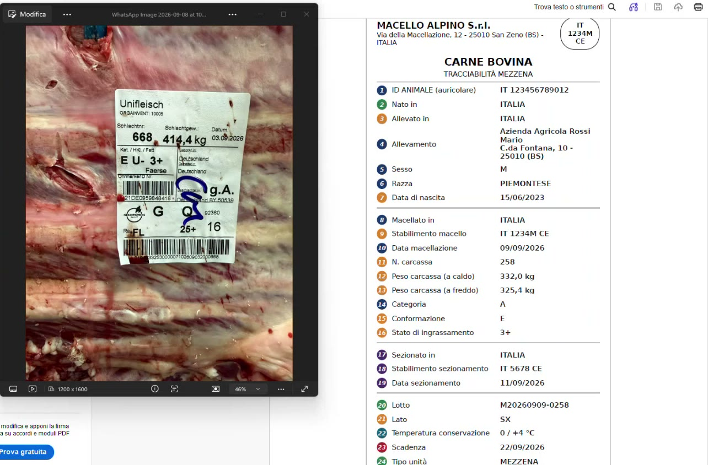
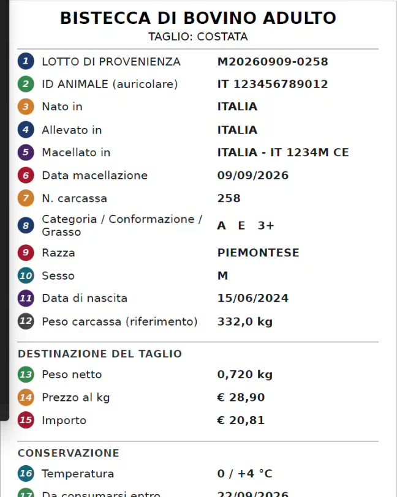

# Tracciabilità: concetti e obblighi

## Obiettivo

Avere chiaro che cosa significa **tracciabilità delle carni**, quali dati accompagnano una mezzena, che cosa deve comunicare il macellaio al consumatore e perché la tracciabilità non va confusa con il **lotto di produzione**. Sono gli argomenti con cui presentarsi a una macelleria.

!!! info "Il riferimento normativo"
    Regolamenti europei, decreti italiani e indicazioni obbligatorie per le carni bovine sono riassunti nella pagina [Normativa europea e italiana](normativa-carni-bovine.md). Tra le indicazioni obbligatorie ci sono anche il Paese di **sezionamento** e i numeri di approvazione del macello e del laboratorio.

## Si parte dalla mezzena

Nella grande maggioranza dei casi la macelleria acquista **mezzene**: l'animale (per esempio un bovino) diviso a metà, in **mezzena destra** e **mezzena sinistra**. Il macello è sottoposto a normative molto rigide: prima ancora che la mezzena entri in macelleria deve essere accompagnata dalla sua "cronistoria" di tracciabilità.

La guida parte dall'animale già sezionato. Il software prevede anche la gestione dell'allevamento, cioè dell'animale durante la crescita, ma non è trattata qui.

*L'etichetta di una mezzena e, a destra, un esempio dei dati che la accompagnano.*

## Da dove arrivano i dati

Le informazioni viaggiano su **etichette** con codici a barre strutturati (EAN 128 / Code 128, GS1). In pratica però l'etichetta sulla carne è spesso insanguinata e illeggibile: non si può fare affidamento sull'acquisizione automatica. I dati da caricare nel software sono quelli riportati sul documento che accompagna la merce: **bolla di accompagnamento**, **foglio di lavorazione** o **fattura**.

!!! info "Il lotto sul documento è un obbligo del fornitore"
    Il fornitore ha l'obbligo di legge di riportare il lotto del prodotto venduto sul documento, che sia una bolla, un foglio di carico o un DDT. Non tutti lo forniscono in formato elettronico, ma il dato deve esserci.

## I dati che accompagnano la mezzena

Nell'esempio la mezzena è accompagnata da **27 informazioni**. Non hanno tutte lo stesso peso:

| Gruppo | Esempi | Note |
|--------|--------|------|
| **Identificazione** | ID animale (auricolare), lotto | Sono due campi distinti: possono coincidere oppure no |
| **Dati obbligatori** | Dove è nato l'animale, dove è stato allevato, dove è stato macellato | Devono essere comunicati e documentati |
| **Dati facoltativi** | Razza, categoria, conformazione, allevamento | Qualificano la carne e il macello che li riporta |

!!! warning "Auricolare e lotto non sono la stessa cosa"
    L'**ID dell'animale** (il cosiddetto auricolare) identifica l'animale di origine. Il **lotto** è il codice assegnato dal macello. Possono avere la stessa sigla, ma dipende dai processi di lavorazione del macello: nell'esempio il lotto è **M20260909-0258** mentre l'auricolare ha un codice diverso.

## Che cosa deve riportare il macellaio

Chi vende un taglio ricavato dalla mezzena (per esempio una bistecca di bovino) deve riportare le informazioni di rintracciabilità di quel prodotto. L'elenco si riduce rispetto a quello della mezzena, ma alcune voci restano essenziali:

- **lotto di provenienza**;
- dove l'animale è **nato**;
- dove è stato **allevato**;
- dove è stato **macellato**.

La **categoria**, invece, non è obbligatoria in tracciabilità. Il macellaio può comunque aggiungere altre informazioni sul taglio.

*Esempio dei dati di un taglio in vendita.*

!!! danger "Scrivere solo il lotto non basta"
    Molti esercenti si limitano a scrivere il lotto su un'etichetta, magari aggiungendo che la carne proviene dall'Italia, e pensano di essere in regola: non è così. Le informazioni non devono essere mendaci e devono corrispondere alla tracciabilità della mezzena in ingresso.

## Le "definizioni tracciabili"

Nel software l'elenco dei dati da riportare si chiama **definizione**: sono le **domande** a cui si risponde quando si registra un nuovo lotto, al carico della mezzena o in vendita. Si configurano una volta sola, d'accordo con il macellaio: vedi [Definizioni tracciabili](definizioni-tracciabili.md).

## Come si informa il consumatore

Il macellaio ha l'obbligo di informare il consumatore sul prodotto che sta acquistando. Lo può fare in due modi:

| Modalità | Quando si usa |
|----------|---------------|
| **Stampa** dei dati tracciabili sullo scontrino o su un'etichetta | Prodotti in take-away (vaschette confezionate) |
| **Esposizione** su una lavagnetta, su un'etichetta elettronica nel banco o sul totem | Vendita assistita al banco |

È un lavoro che richiede tempo: in una macelleria media di paese arrivano almeno **due mezzene a settimana**, quindi due lotti da gestire. Con la suite l'esposizione è automatica: il totem [DeLine Ticket](totem-eliminacode.md) mostra i dati dei lotti in vendita in quel momento.

## Tracciabilità e lotto di produzione

| | Tracciabilità | Lotto di produzione |
|---|---------------|---------------------|
| **Che cosa identifica** | L'origine della carne acquistata (la mezzena) | Un prodotto lavorato in proprio (macinato, polpettone) |
| **Quando nasce** | Al carico del documento del fornitore | Quando si esegue una trasformazione |
| **Esempio** | Filetto tagliato dalla mezzena: sullo scontrino va il lotto della mezzena | Polpettone: lotto interno, collegato ai lotti di tutti gli ingredienti |

!!! tip "Come presentarlo al cliente"
    Per i macellai la tracciabilità è spesso "un incubo". L'argomento è mostrare che i processi diventano semplici: si carica la bolla e in vendita si sceglie il lotto, tutto il resto lo fa il sistema.
