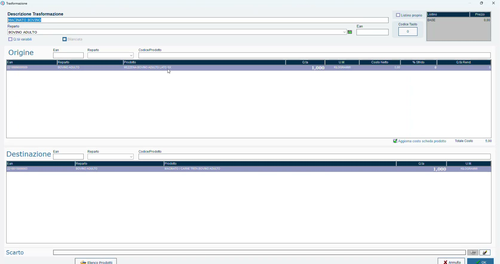
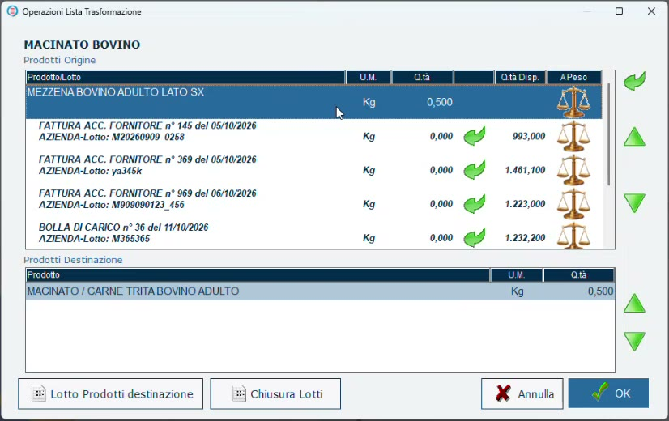

# Dalla mezzena al macinato

## Obiettivo

Eseguire la prima e più semplice **trasformazione**: ricavare il macinato dalla mezzena, scegliendo il lotto di origine e assegnando al macinato il suo **lotto di produzione**.

## Prerequisiti

- Mezzena caricata a magazzino con il lotto ([Carico della mezzena e del lotto](carico-mezzena.md)).
- Articolo macinato con **Produzione Propria** attivo ([Articoli: mezzena, tagli e macinato](articoli-mezzena-tagli.md)).

## Perché serve una trasformazione

Finché si vende un taglio, il lotto resta quello della mezzena. Il macinato invece è una **lavorazione**: nasce un prodotto nuovo, con un proprio lotto, che deve restare collegato al lotto di carne da cui proviene.

## Passaggi

### 1. Il modello di trasformazione

Il modello è la scheda che dice **da che cosa si ricava che cosa**. Si crea una volta sola da **Modelli Trasformazioni**.

- **Origine**: la mezzena di bovino (lato sinistro e lato destro), per esempio 1 kg.
- **Destinazione**: il macinato di bovino, 1 kg.

*Il modello del macinato: da un chilo di mezzena, un chilo di macinato.*

Il modello può essere più dettagliato:

- aggiungendo in origine gli **aromi** e i componenti usati per la conservazione;
- per un **macinato misto**: mezzo chilo di mezzena di bovino e mezzo chilo di mezzena di suino diventano un chilo di macinato misto.

### 2. Esegui la trasformazione

1. Apri **Trasformazioni** e premi **Aggiungi**.
2. Scegli il modello del macinato e indica la quantità da produrre (nell'esempio **500 g**).
3. Il programma calcola quanta mezzena serve (500 g) e mostra **tutte le mezzene caricate a magazzino con i relativi lotti**, documento per documento, con la quantità disponibile.
4. Scegli il lotto di mezzena da cui prelevare.
5. Con **Lotto Prodotti destinazione** scrivi il **lotto di produzione** del macinato.
6. Conferma con **OK**.

*Per ogni documento di carico sono indicati il lotto e la quantità ancora disponibile.*

!!! tip "Che lotto dare al macinato"
    Il lotto di produzione può **coincidere con il lotto di origine** della mezzena, oppure si può aggiungere una sigla accanto per distinguerlo.

## Che cosa succede

- Il peso della mezzena usata viene **scaricato** dal lotto di origine.
- Anche questa lavorazione viene **comunicata alla bilancia**: il macinato può essere venduto, per esempio in vaschetta con l'etichetta ([Etichette parlanti e immagini](etichette-parlanti.md)).

## Verifica

- La trasformazione compare nella **Lista Trasformazioni** con il lotto assegnato ([Rintracciabilità dei lotti](rintracciabilita-lotti.md)).
- Sulla bilancia il lotto del macinato è disponibile in vendita.

## E dopo il macinato?

Il macinato può subire **ulteriori trasformazioni**: diventa un ingrediente di polpette, polpettoni, sughi. È l'argomento delle pagine successive, a partire da [Prodotto finito e ingredienti](prodotto-finito-ingredienti.md).
