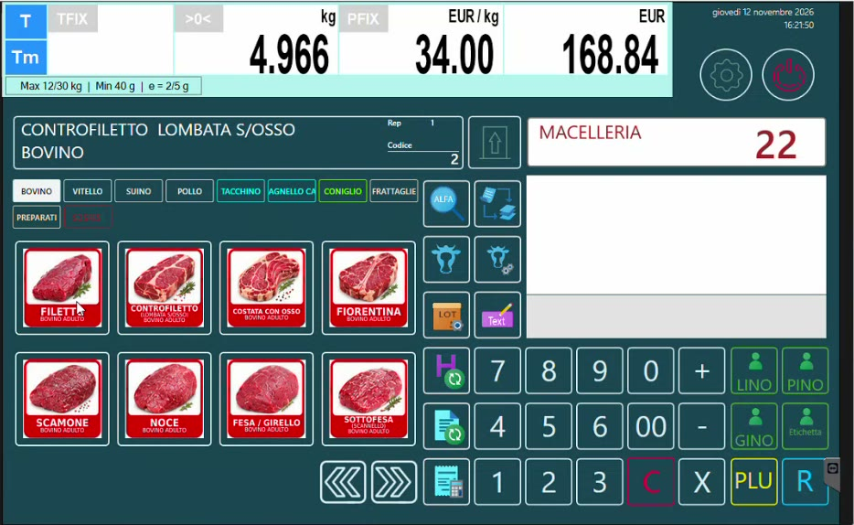
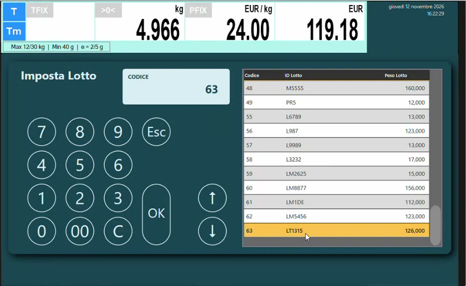

# Vendita al banco con il lotto

## Obiettivo

Vendere dalla bilancia Icona un taglio ricavato dalla mezzena scegliendo il **lotto** di provenienza, e verificare che il **peso del lotto** si scarichi a ogni pesata.

## Prerequisiti

- La mezzena è stata caricata in HyperStore con il suo lotto ([Carico della mezzena e del lotto](carico-mezzena.md)).
- I tagli sono presenti sulla tastiera della bilancia.

## Passaggi

1. Sulla bilancia scegli la **categoria** (nell'esempio BOVINO, VITELLO, SUINO, POLLO e le altre della macelleria) e tocca l'articolo, per esempio la **noce**.
2. Si apre la schermata **Imposta Lotto**: la bilancia propone i lotti che ha in memoria, con **Codice**, **ID Lotto** e **Peso Lotto**. In fondo all'elenco c'è il lotto appena caricato da HyperStore (nell'esempio **LT1315**, 126,000 kg).
3. Seleziona il lotto e conferma con **OK**.
4. Completa la pesata, assegnala all'operatore e chiudi lo scontrino.

*La schermata di vendita con le categorie e i tasti articolo.*

*Imposta Lotto: l'ultimo della lista è il lotto LT1315 caricato poco prima in HyperStore.*

## Che cosa succede

- Il **peso del lotto scende**: nell'esempio, dopo una pesata di circa 5 kg, il lotto da 126 kg passa a circa 121 kg.
- Sullo scontrino il lotto riportato **coincide con quello della mezzena**: il prodotto ha subito un taglio, non una trasformazione.
- Alla cassa **Hyperetail** si legge il QR code dello scontrino della bilancia e lo scontrino viene "esploso" come di consueto.

## Opzioni di funzionamento

| Opzione | Scelte possibili |
|---------|------------------|
| **Dati tracciabili sullo scontrino** | Stampati oppure no. Se i dati sono esposti sul totem o su una lavagnetta, la stampa non è obbligatoria |
| **Richiesta del lotto** | Scelto una volta e mantenuto per tutti i prodotti di quella categoria, oppure richiesto a ogni articolo |

!!! note "Tasti con le immagini"
    Nelle schermate di esempio i tasti sono grandi e con richiamo grafico per mostrare le potenzialità della bilancia: sono scenografici, ma in vendita per il macellaio risultano scomodi.

## Verifica

1. Dopo la vendita richiama un altro articolo della stessa mezzena.
2. In **Imposta Lotto** il **Peso Lotto** deve essere diminuito del peso venduto.

!!! tip "Il messaggio per il macellaio"
    "Tu carichi solo la bolla e in vendita selezioni il lotto": la cronistoria della mezzena si costruisce da sola.
